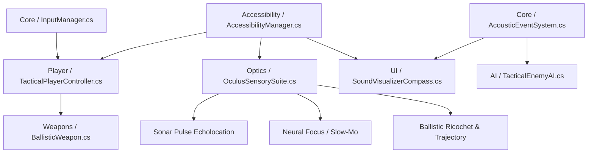

# 🧠 PROJECT MEMORY & MULTI-AGENT COORDINATION PROTOCOL
**Project:** *Echoes of Neon* — Accessible Tactical Cyber-Noir FPS  
**Target Engine:** Unity 6.6.0f1 (installed, real project exists - see Changelog)  
**Location:** `~/Developer/EchoesOfNeon/` (moved 2026-09-14 from `~/Desktop/EchoesOfNeon`
- see below; update any tool/shortcut still pointing at the old Desktop path)  
**Last Updated:** 2026-09-29 (Marcus + Cookie guide dog, accessible main menu, environment concept art - see the 2026-09-29 resume point)  
`~/Desktop` to fix the build-stall problem for good; build-verify now passes clean,
audio imports and the `PulseFrom` refactor both confirmed working)  

> [!NOTE]
> ### Resume point (2026-09-29, end of a long session - everything below is committed and pushed)
> **State:** the game has a real, tested character layer. Marcus (CC0 Quaternius human, recolored/scaled, cane, glasses, no
> phone) is wired to the real `TacticalPlayerController`; Cookie (CC0 Quaternius dog, cyber-modified) is an automatic guide
> dog (`CompanionGuide` + `CompanionAudio`: leads, waits, returns, arrives; followed by ear via 3D pawsteps + collar). Also
> built this session: the accessible main menu (narrated components, save system, options tabs, two-tier font), environment
> concept art (workshop, Desi's lab, Madame's penthouse), and decisions (stay on Unity; no OpenSCAD; FMOD recommended).
> Everything was verified by compilers and batch-mode Play Mode tests with SIMULATED input - **nothing has been heard or seen
> by a human**: no VoiceOver test of the menu, no headphone check of the guide-dog audio (an 88 s offline preview was sent to
> Orlando on 2026-09-29), no live look at the characters.
> **Do first next time:** (1) Orlando's verdict on the guide-dog audio preview + a real VoiceOver pass over the menu;
> (2) pick one menu click (`Assets/Audio/UI/`) and wire it to AccessibleButton/Toggle/Slider `invoked`; (3) audition the 3
> ondrosik.sk menu-music candidates in `~/Desktop/Echoes of Neon/02 Concept Art and Ideas/Sound and Music References/` (or export the real Ableton theme).
> **Then:** obstacle avoidance/pathfinding for Cookie and mission-driven objectives; wire Marcus/Cookie footsteps (assets exist);
> bloom so cyan actually glows; loop-trim the Sonniss weather/lab masters (kept OUT of git - see `.gitignore`); Marcus goatee/
> glasses polish; higher-fidelity Cookie via local TRELLIS.2 if the Mac has 24 GB+; obstacle: TextMeshPro was added but unused;
> fix the keybindings screen showing "-" instead of key names (logged bug); concept-art `edits/` not yet swapped in as
> canonical; radio mechanic and cutscene audio-description still need design; resistance base / black market / tower art.
> **Tool traps learned (details in the changelog entries dated 2026-09-28/29):** Blender hangs at `_dyld_start` until the
> Homebrew-quarantined app is opened once from Finder; Adobe-for-Creativity connector cannot generate or ingest outside
> images; Play Mode tests need Input System focus flags + 60 fps cap; Blender FBX export skips hidden objects; Unity `??` on
> components is unreliable.

> [!NOTE]
> ### Resume point (2026-09-14, night - project moved, build-verify finally passes)
> Orlando's "yes generate the ambient stuff and make the midi files" is done and
> pushed: two ambient WAV beds in `Assets/Audio/Ambient/`, two MIDI music sketches + a
> README in `Docs/Story/Audio/Music/`, generation scripts preserved in
> `Docs/Story/Audio/generation-scripts/`. **Update 2026-09-16: Orlando has now heard
> and approved all of it** - the 6 enemy bark clips, both ambient beds, and both MIDI
> sketches - no changes requested, alongside the new Ableton theme/SFX (see the
> 2026-09-16 changelog entry). This closes a long-standing "never heard" blocker on
> all of this project's existing audio.
>
> **The iCloud build-stall problem (three distinct causes found across this session -
> plain iCloud churn, a stale Xcode/Instruments session, and an iCloud conflict-
> duplication storm on `Library/PackageCache`) is now resolved for good**, per
> Orlando's choice of the heavier fix: the whole project moved from
> `~/Desktop/EchoesOfNeon` to **`~/Developer/EchoesOfNeon`**, out of iCloud's Desktop &
> Documents sync entirely.
>
> **How the move was actually done** (worth keeping for any future project that needs
> the same fix): a plain `mv` **deadlocked at the kernel level** - `sample`-ing the
> stuck `mv` process showed 100% of samples blocked inside a single `rename()` syscall,
> presumably waiting on File Provider IPC that never completed, for 10+ minutes with
> zero progress. Since POSIX `rename()` is atomic, it was safe to `kill -TERM` it - the
> project reverted fully and cleanly to its original location with no partial state,
> verified by file count and git status. Switched to `ditto -v` instead (copies file-
> by-file via normal reads rather than one atomic directory-rename operation) - this
> completed successfully with real, steady progress the whole way (no deadlock), and
> was verified byte-for-byte against the source with `diff -rq` (empty output) plus a
> file-count and total-size match before the original was deleted. **Lesson: don't
> `mv`/rename a directory out of iCloud-managed `~/Desktop` - copy with `ditto` (or
> `rsync`) and delete the original only after verifying, since directory rename here
> can deadlock in a way a signal can safely interrupt but a plain retry won't fix.**
>
> **Build-verify from the new location passed clean on the first try** - the batch-mode
> Mac build finished in well under a minute (previously it never got past the ~19KB
> package-registration stall), zero real compiler errors (`grep -c "error CS"` = 0;
> the build report's own `errors=23827` count is the already-known-unreliable
> `BuildReport.summary.totalErrors` metric, not real - see the Problem Solving history
> for why that number can't be trusted directly), and produced a real, freshly-
> timestamped 73MB player binary that launched without crashing. This also finally
> verifies the `OculusSensorySuite.PulseFrom` refactor from the entry below compiled
> and built clean. The zero-byte `Player.log` on launch is the already-documented,
> unrelated macOS Accessibility-permission hang (see further down this file) - not a
> new problem introduced by the move.
>
> **Unity Hub's project list (`~/Library/Application Support/UnityHub/projects-v1.json`)
> was checked and is empty** (`{"data":{}}`) - this project was never opened through
> Hub's own GUI, so there was nothing to update there. If Orlando ever adds it to Hub
> going forward, add it from the new `~/Developer/EchoesOfNeon` path.
>
> **Also this session**: reformatted `Docs/Story/Dialogue/dialogue-intake-form.md` to
> show current answers vs. genuinely open items (matching the pattern already used in
> `Narrative/story-intake-form.md`), and added `Docs/Story/Dialogue/scripts/
> marcus-recording-sheet.md` - the same 6 Marcus lines as `marcus-cross-script.md`,
> reformatted as a sequential read-and-record sheet instead of a wide reference table,
> since Marcus is the one character Orlando is voicing himself.
>
> ### Resume point (2026-09-13, blueprint-gap session)
> Orlando shared an "Accessible Unity Game Blueprint" template and asked what parts of
> it this project hasn't touched yet. Answer: engine/systems work (Phases 0-6 below)
> is far along, but the entire narrative layer, the dual review-agent system, and docs
> infrastructure didn't exist at all. This session built that missing layer - see
> `CLAUDE.md` (new) and the `Docs/` tree (new, see directory map below) - plus fixed a
> real code gap an audit found: `AccessibilityManager.Announce()` was never called
> anywhere in gameplay code before this session, despite the hook existing and
> compiling. See the Changelog entry below for exactly what changed.
>
> **Two new environment gotchas found this session, both relevant next time a build
> needs verifying:**
> 1. **Rebuilding after Library predates code changes can produce a corrupted
>    player** - hit a `level0` "is corrupted!" crash on first launch after building
>    with an existing `Library/`. Same class of issue as the tvOS/Mac switch bug
>    already documented further down this file. Fix was the same: delete `Library/`
>    (and `Temp/`) and let Unity do a full clean reimport before rebuilding. If a
>    freshly-built player crashes with a "corrupted" data-file message, this is the
>    fix - don't assume it's a real code bug first.
>
>    **Sharpened overnight 2026-09-14 after hitting the silent batch-mode stall three
>    times in a row.** The stall signature is exact and recognizable: the log stops at
>    ~18KB right after `[Package Manager] Done registering packages`, Unity sits at
>    ~0.4% CPU indefinitely, and **no `.meta` files get generated** (asset import never
>    happens). What was learned:
>    - It is **not** caused by importing audio/`.mp3` assets. That was the obvious
>      hypothesis (the only new assets at the time) and it was tested by moving the
>      audio out of `Assets/` entirely - it stalled identically without them.
>    - It is **not** Spotlight this time (`mdworker_shared` count was 0, unlike the
>      documented indexing-storm incident).
>    - The likely chain: the *first* stall coincided with heavy iCloud activity
>      (`fileproviderd` at 72%, `iCloudDriveCore` at 26%) - **this project lives in
>      `~/Desktop`, which is iCloud-synced**, so iCloud was churning the project tree
>      while Unity tried to import it. Then `kill -9`-ing that stalled Unity mid-import
>      corrupted `Library/`, which made every *subsequent* run stall at the same point
>      for a different reason than the first.
>    - **The fix that actually worked: `rm -rf Library Temp`, recreate them with their
>      `.metadata_never_index` markers, and rerun.** It then completed in ~40s with the
>      log growing to 1.4MB and CPU at 75%.
>    - **Lesson: never `kill -9` a batch-mode Unity that's mid-import** unless you're
>      prepared to wipe `Library/` afterward - the kill converts a transient stall into
>      a persistent one.
>    - **Recurred again 2026-09-14, ~1AM, with iCloud confirmed quiet this time**
>      (`fileproviderd`/`iCloudDriveCore` all at 0%) - so iCloud contention isn't the
>      only trigger. `sample`-ing the stuck process this time got real data instead of
>      guessing: 777/777 samples landed on the identical frame, a genuinely blocked
>      kernel `read()` syscall inside `FileHasher::ComputeFileHashJob` (Unity hashing a
>      file during its asset scan) - not a CPU spin, a real stuck I/O. **New suspect:
>      a stale Xcode session had this exact project's tvOS build
>      (`Builds/TestRange-tvOS/Unity-iPhone.xcodeproj`) open since the previous
>      Saturday**, contending for the same file tree. Not proven as the cause, but it's
>      the one thing that changed between a clean run and a stalled one. **This time,
>      `kill -TERM` (not `-9`) was tried first and the process exited cleanly** within
>      15s instead of needing a hard kill - worth trying SIGTERM before SIGKILL on this
>      stall going forward, both because it's less likely to corrupt `Library/` and
>      because it worked. The code change pending verification when this happened
>      (`OculusSensorySuite.PulseFrom`, see the Cookie/sonar unification changelog
>      entry) was reviewed carefully by eye instead of build-verified, and should get a
>      real build-verify next session before being trusted further.
>    - **Standing recommendation for Orlando (not acted on - his call):** consider
>      moving this project out of `~/Desktop`. Unity's `Library/` and `Temp/` churn
>      thousands of files constantly, and having iCloud try to sync all of that is
>      pathological. Somewhere like `~/Developer/` would remove a whole category of
>      these stalls. Not done unilaterally because it would touch Unity Hub's project
>      list, any Antigravity workspace path, and this file's own path references.
> 2. **A freshly-rebuilt Mac binary may trigger a NEW macOS Accessibility permission
>    prompt** - after the clean rebuild above, the app process launched and stayed
>    alive but produced zero Unity engine log output; the macOS unified log showed a
>    `TCCAccessRequest` (Accessibility service) IPC call right before it went quiet,
>    consistent with a system permission dialog blocking headless progress. Couldn't
>    confirm or dismiss this without GUI interaction - **check System Settings >
>    Privacy & Security > Accessibility for `EchoesOfNeon_Test` next time this
>    happens, and grant it if prompted.** This is a different permission than the
>    already-documented Input Monitoring one below - likely triggered by
>    `AssistiveSupport.activeHierarchy` usage in `AccessibilityManager.cs`, though
>    that's not yet confirmed as the actual cause.
>
> **Google Antigravity is also being used on this project now** (confirmed running on
> this Mac this session). Agreed approach with Orlando: never run both tools on the
> same working directory at once, commit before switching between them, check `git
> log`/`git status` at the start of either tool's session, and point Antigravity at
> this file too - its "Mandatory AI Agent Protocol" is written for "an AI agent," not
> specifically Claude.
>
> **Narrative content deliberately NOT drafted this session** - Orlando asked for
> fill-in intake forms (open questions) instead of a fully-drafted story bible/
> characters/scenes, so `Docs/Story/Narrative/story-intake-form.md`,
> `.../Dialogue/dialogue-intake-form.md`, and `.../Audio/audio-intake-form.md` are
> questionnaires, not content. **Next session, in order:**
> 1. Answer those three intake forms (or as much as is ready) - everything
>    downstream (character files, scene files, the narrative review checklist
>    actually being runnable) depends on them.
> 2. Get a real live Mac test in - VoiceOver on, real keyboard/controller - covering
>    both the long-standing open items in `Docs/playtest-log.md` (carried over from
>    before this session) AND this session's new announcements (enemy state changes,
>    Neural Dilate, sonar contact, footstep audio). If the Accessibility-permission
>    hang above recurs, that's the first thing to resolve before anything else can be
>    tested.
> 3. Only then continue toward the rest of Phase 6 (shaders, real level design) -
>    both still need visual verification a human has to do.

---

> [!IMPORTANT]
> ### 🤖 MANDATORY AI AGENT PROTOCOL (READ BEFORE MAKING CHANGES)
> If you are an AI agent working on this codebase:
> 1. **READ FIRST:** Review this entire `MEMORY.md` file before starting any task to understand current architecture, conventions, and active work.
> 2. **CHECK ACTIVE WORK:** Look at the **[Task Tracking & Roadmap](#-task-tracking--roadmap)** section to avoid duplicate work or stepping on in-progress tasks.
> 3. **PRESERVE ARCHITECTURE & PREVENT REGRESSIONS:**
>    - Do not refactor or remove existing public APIs/events without backward compatibility.
>    - Ensure all scripts adhere to decoupled event-driven architecture.
>    - Keep accessibility options modularized through `AccessibilityManager`.
> 4. **UPDATE THIS FILE AFTER EVERY TASK:** Whenever you create, modify, or test scripts, you **MUST** update:
>    - The **[Changelog & Activity Log](#-changelog--activity-log)** with your changes, files touched, and notes.
>    - The **[Task Tracking & Roadmap](#-task-tracking--roadmap)** status (mark tasks completed or add new sub-tasks).
> 5. **BUILDER + BLIND CRITIC FOR ANYTHING NEEDING VISUAL JUDGMENT** (added 2026-09-17,
>    adapted from Matt Shumer's "Gauntlet Loop" technique): Orlando is blind and cannot
>    verify shaders, level layout/pacing, 3D rig/animation quality, or rendered visual
>    output by eye — and past sessions have correctly refused to write that kind of work
>    "blind" rather than produce unverifiable output (see the Phase 6 shader/level-design
>    entries below). Going forward, for exactly this category of work: spin up a
>    **builder** subagent to produce the artifact, then a **separate, blind critic**
>    subagent that never sees the builder's reasoning or prompt - only the resulting
>    output (a rendered screenshot, an exported animation clip, a build) - and grades it
>    against a concrete, named real-world reference (a reference image, a professional
>    game's equivalent system, a stated spec). Only accept the result if the critic
>    agrees it clears that bar; otherwise loop. This does not replace Orlando's own
>    verification where it's required (gameplay feel, story judgment calls) - it's
>    specifically for closing the "nobody sighted looked at this" gap on visual-only
>    correctness checks (does a shader render as intended, does a rig deform without
>    obviously broken geometry, does a walk cycle look like walking) using a
>    multimodal subagent's own image-reading ability as the sighted-equivalent check.

---

## 🎮 Game Concept & Lore Bible

* **Title:** *Echoes of Neon*
* **Genre:** Single-Player Tactical / Methodical Cyber-Noir First-Person Shooter (FPS).
* **Setting:** *New Carthage* — A rain-slicked, neon-lit industrial metropolis controlled by monolithic mega-corporations.
* **Protagonist:** **Marcus "Echo" Cross**
  * Former military breach specialist turned industrial contractor.
  * Monolithic mega-corp **Aegis-Corvus Dynamics** murdered his family, stole his late wife's neural memory core, and destroyed his biological eyes to cover up illegal bioweapons experiments.
  * Rebuilt with an underground prototype cybernetic ocular suite (**Oculus Sensory Suite**), Marcus seeks revenge and answers.
* **Core Design Philosophy:** Accessibility is not an afterthought menu toggle—it is woven directly into the in-lore cyberware, HUD optics, acoustic visualization, and tactical pacing.

> [!NOTE]
> **2026-09-14**: a sixth character joined the cast - **C.O.Q.I. "Cookie,"** Marcus's
> companion, a black lab built by Desi with cybernetic flesh-bonding limbs (10x
> normal strength) and a wireless link that lets her speak in a voice only Marcus can
> hear. She scouts and locates threats and is lethal up close - explicitly not a
> finished ability list. See `Docs/Story/Characters/cookie.md`. Her existence may also
> answer why Desi's lab was targeted at all (see the story bible's open questions) -
> flagged, not confirmed.
>
> **The full story bible now lives in `Docs/story-bible.md` and `Docs/Story/Characters/`
> and `Docs/Story/locations.md`** (drafted 2026-09-13 from Orlando's answered intake
> forms) - that's the current, more detailed source; this section stays as a quick
> summary. Key additions worth knowing at a glance: the antagonist has a name now -
> **The Madame**, head of Aegis-Corvus Dynamics for 10+ years - and Marcus has two
> other named major characters: **Desdemona "Desi" Cross** (his late wife, a
> bio-mechanical molecular researcher, appears via memory/dream only) and
> **Maximilian "Max" Gomez** (his military brother and tech supplier, carrying an
> undisclosed secret that's a deliberate planted setup, not yet resolved). The
> ending involves a familial revelation about The Madame and a supernatural twist -
> deliberately not detailed further until Orlando decides what it actually is.

---

## 🏛️ Core Architectural Pillars & Systems



### 1. Accessibility & Assist Framework (`Assets/Scripts/Accessibility/`)
* **Colorblind Modes:** Full palette swaps (Protanopia, Deuteranopia, Tritanopia, High-Contrast Monochroma).
* **High-Contrast Silhouettes:** Screen-space outline shaders for enemies (red/amber), allies (cyan/green), and interactables (gold).
* **Granular Aim Assists:** Sliders for target friction (slowdown over targets) and soft magnetic snap-to-target.
* **Motor Assists:** Single-stick navigation mode, full toggle vs. hold options (ADS, Sprint, Crouch), adjustable sensitivity curves.
* **Timescale Control:** Adjustable speed multiplier during *Neural Dilate* (slow-mo).
* **Sensory Cues:** Motion sickness reduction (camera bob toggle, screen shake scaling).

### 2. Dual-Input Versatility (`Assets/Scripts/Core/`)
* Built upon **Unity New Input System** (`UnityEngine.InputSystem`).
* Seamless hot-swapping between Keyboard & Mouse and Gamepads (Xbox, PlayStation, Generic).
* Full runtime remapping with persistent JSON serialization.
* Deadzone calibration and dynamic UI button glyph updates.

### 3. Oculus Sensory Suite (`Assets/Scripts/Optics/`)
* **Sonar Pulse (Echolocation):** Expanding acoustic wave that pings geometry edges, hidden enemies, and sound sources.
* **Neural Dilate (Focus Mode):** Overclocks perception to slow down game time (`Time.timeScale`) without making player controls sluggish.
* **Predictive Ballistics:** Real-time projected ricochet trajectory and laser sighting.

### 4. 3D Sound Visualizer Compass (`Assets/Scripts/UI/`)
* Captures spatial acoustic events from `AcousticEmitter` components.
* Plots directional radar blips around the HUD / crosshair:
  * 🟠 Orange = Gunfire / Explosions
  * 🔵 Cyan = Footsteps / Movement
  * 🟡 Yellow = Mechanical / Alert Barks
* Integrated with enhanced subtitles (speaker portraits, directional indicators, high-contrast backgrounds).

### 5. Ballistic Combat & Tactical AI (`Assets/Scripts/Weapons/` & `Assets/Scripts/AI/`)
* **Vanguard 9 Suppressed Pistol:** Modular cyberware weapon framework (semi-auto, recoil damping, laser guide).
* **Acoustic Stealth Loop:** Enemies respond to noise radius and visual lines of sight; player uses sonar to assess threat levels.

---

## 📁 Directory Structure & File Map

```
EchoesOfNeon/
├── Assets/
│   ├── Scenes/                 # Level grayboxes, test ranges, lighting setups
│   ├── Scripts/
│   │   ├── Core/               # InputManager, GameManager, AcousticEventSystem
│   │   ├── Player/             # TacticalPlayerController, PlayerMotor (no PlayerHealth yet - see action-mapping.md)
│   │   ├── Accessibility/      # AccessibilityManager, ColorblindProfile, InputRemapData
│   │   ├── Optics/             # OculusSensorySuite, SonarPingEmitter, TrajectoryDrawer
│   │   ├── Weapons/            # BallisticWeapon, Projectile, WeaponCyberMod
│   │   ├── AI/                 # TacticalEnemyAI, AcousticEmitter, VisionCone
│   │   └── UI/                 # SoundVisualizerCompass, SubtitleDisplay, AccessibilityMenuUI
│   └── Shaders/                # HighContrastOutline, SonarPulseWave, ScreenSpaceSilhouette
├── Docs/                       # Created 2026-09-13 (was aspirational-only before)
│   ├── action-mapping.md       # Blueprint Section 3.4 - action -> Animator/audio/announcement
│   ├── code-review-checklist.md
│   ├── narrative-review-checklist.md
│   ├── playtest-log.md
│   ├── asset-credits.md
│   └── Story/
│       ├── Narrative/story-intake-form.md   # Open questions, not drafted content yet
│       ├── Dialogue/dialogue-intake-form.md
│       ├── Audio/audio-intake-form.md
│       ├── Characters/         # Empty - waiting on the Narrative intake form's answers
│       └── Scenes/             # Empty - waiting on the Narrative intake form's answers
├── CLAUDE.md                   # Added 2026-09-13 - points any Claude Code session at this file
├── MEMORY.md                   # 🧠 THIS FILE - Master context and agent synchronization
└── README.md                   # Quickstart guide for opening in Unity
```

---

## 🎯 Task Tracking & Roadmap

Reordered into phases 2026-09-09 to put input first (explicit user priority:
keyboard **and** game controller support) and to call out the screen-reader
architecture decision below. See the Changelog for tooling setup detail.

> [!IMPORTANT]
> ### 🦯 Screen-reader architecture decision (2026-09-09)
> Menus/UI use **Unity 6.3's native `AccessibilityNode`/`AccessibilityHierarchy`
> API** (`UnityEngine.Accessibility`), which exposes UI through Windows UI
> Automation — the same standard API NVDA reads other apps through. This is
> *why* the project targets **Unity 6.3 (`6000.3.23f1`)** instead of the 6.0
> LTS line, which predates this API entirely. Unity's own docs only list
> "Windows Narrator" as tested, not NVDA by name, but the mechanism is
> standard UIA, not Narrator-specific — NVDA compatibility is expected but
> **not yet empirically verified**; confirm live once a menu exists.
> **Live gameplay does not go through a screen reader at all** — that's what
> the Oculus Sensory Suite (sonar echolocation, sound-visualizer compass) is
> *for*. Screen readers are for static menu/UI screens only.

| Phase | Task / Feature | Module | Status | Owner / Agent | Target File(s) |
| :--- | :--- | :--- | :--- | :--- | :--- |
| **2026-10-11 (15-role studio audit + fixes; decisions: 2.5D side-scroller ships, Marcus can kill, NATIVE not web)** | Claude | Six read-only audit agents (report: `~/Desktop/Accessible Game Studio/Echoes of Neon - Studio Audit Report.md`). Orlando approved the fix order. Built and committed: scene-change lifecycle fixes (`UpgradeManager`, `OculusSensorySuite`, `SideScrollPlayer` subscriptions); dead enemies silent on sonar; rebind Escape-cancel, conflict warning, spoken failure; **Cookie can be downed** (splash from hits within 2.5 m) and **revives a downed Marcus** (4 s, 35% health, 45 s cooldown), else rest-point 'responders' respawn restores both, progress kept; **combat drops** (`CombatRewards.cs`: full-health pack / Cookie treat, 30% base, 60% when hurt, guaranteed after 4 dry kills); spoken toggle/slider values without a screen reader; hold-to-toggle announcements; **speech priority queue** (`SpeechQueue`: Critical/High/Normal/Low); **Windows speech fallback** (persistent hidden PowerShell + System.Speech, untested on real Windows); **visual wind-up telegraph** (`WindUpTelegraph`: amber bar = fendable, red diamond = unblockable); **audio occlusion** (`AudioOcclusion`, low-pass from Marcus's head) and **ducking** (`AudioDucking`, music under High/Critical speech). Middleware: built-in Unity audio, FMOD dropped (Studio not shown to be screen-reader usable), Steam Audio deferred - see `Docs/audio-cue-spec.md`. 85 tests pass headless via command line (52 EditMode + 33 PlayMode). **Nothing human-verified.** | `Assets/Scripts/**`, `Assets/Tests/**`, `Docs/audio-cue-spec.md` | Next: Orlando's VoiceOver + headphone playtest (revive, drops, queue, occlusion depth); Windows test on winterfell; Sonniss swap; narrative fixes (LoreClues vs canon, refusal arc vs kills). Tool note: PlayMode tests time out through the Unity MCP bridge but pass with `Unity -batchmode -runTests -testPlatform PlayMode` when the editor is not running. |
| **2026-10-10 (Master folder created on the Desktop)** | Claude | Orlando asked to collect every Echoes of Neon file into one master folder. Created `~/Desktop/Echoes of Neon/` with 01 Game Project (Unity) (a symlink to this repo, which was NOT moved), 02 Concept Art and Ideas (the old EchoesOfNeon_ConceptIdeas folder, subfolders renamed, plus a new Story and Story Ideas folder with the compiled Scenes 01 to 13 script, canon copies and a folder per writer), 03 Music and Ableton Projects, 04 Technical Stuff for the Game, 05 Story Documents and Archives. | No project files changed; only the stale concept-art path on the menu-music line near the top of this file. | `~/Desktop/EchoesOfNeon_ConceptIdeas` no longer exists; use the path above. Copies of the script and canon log in the master folder are snapshots, the repo copies stay the source of truth. |
| **2026-10-09 (Music direction, narrative doc, list review, Ableton license)** | Claude | **Music decision (Orlando): he composes in Ableton + GarageBand, NOT Suno.** Nine Suno prompt folders were made at `~/Desktop/EchoesOfNeon_ConceptIdeas/Suno/` (unused; usable as composition briefs). Verified Suno facts: no official API/MCP; Pro has commercial rights but 20 downloads/month; AI-only output likely not copyrightable (US Copyright Office Jan 2025, Thaler cert denied 2026-03-02) and Steam wants AI disclosure. Three agents reviewed the awesome-ai-music-generation list: weak fit; only SuperCollider, ACE-Step 1.5 (MIT, untested), a Demucs+pyloudnorm+ffmpeg stem/master script and MusPy are worth following up; skip MusicGen/TTS WebUI (non-commercial weights). **Ableton license settled by Orlando**; Log.txt shows `IsUnlocked?=true` (checked 2026-10-09 12:12); the theme still needs rebuilding from `~/Documents/EchoesOfNeon_AbletonBackup/`, saving and bouncing. Built `~/Desktop/Echoes of Neon - Narrative Working Document.docx` (2026-10-08) from the older story files; **it is now OUT OF DATE** (it carries a notice) because another session committed a new canon (`a209549`: `Docs/Story/story-canon-log.md` wins over the story bible; ending The Chair, amnesia, Ignatius Corvus, Cass, katana). Committed `Docs/unity-spark-and-ai-tooling.md`. | `MEMORY.md`, `Docs/unity-spark-and-ai-tooling.md` | Next: Orlando's playtest of accessibility milestones 2-4; rebuild + save the Ableton theme; compose cues in Ableton/GarageBand; optionally trial ACE-Step or a stem script. Two sessions edit this repo: check `git log` first and stage only your own files. |
| **2026-10-08 (Unity Spark research + AI plans doc)** | Claude | Orlando joined the Unity Spark closed beta. Three research agents + page reads: Spark is browser-only (Chrome), new projects only, no reported export/MCP/CLI, accessibility and data/IP terms unpublished, so it cannot be used on this project today. Wrote `Docs/unity-spark-and-ai-tooling.md`: findings, Unity plan table (Personal free under $200K; Pro $210/month; Unity AI assistant $10/month on Personal), a conflict about whether the official MCP server needs a paid plan (Unity's page says no), a sandboxed trial plan, and an acceptance checklist. Nothing uploaded to Spark. | `Docs/unity-spark-and-ai-tooling.md`, `MEMORY.md` | Next: Orlando tests Spark's UI with VoiceOver when access arrives and reads the beta terms before any upload. |
| **2026-10-08 (Accessibility Milestone 4: rebinding, toggles, difficulty, onboarding; + startup-order bug fix)** | Claude | `InputManager`: composite-part rebinding via `Move:Up`-style names (`SplitActionName`; Input System requires the action DISABLED before `PerformInteractiveRebinding(index)` - a test caught that), new `Hint` action (F1). `ControlsGuide` speaks live bindings. `FirstRunPrompt` (once for menu, once for gameplay, PlayerPrefs). New settings `toggleDilate`, `difficulty`, `timingAssist` + `DifficultyRules`; consumers: `OculusSensorySuite` (toggle), `SideScrollPlayer` (damage, fend window; sprint/crouch now go through `AccessibilityManager` events so Toggle Sprint/Crouch finally work in the side-scroller), `SideScrollEnemy` (wind-up). Keybinding tab rebuilt in two columns (24 rows; old layout ran off-screen) and `KeybindRow` now exposes the current key as the button's spoken hint. **Real bug fixed:** `AccessibleButton/Toggle/Slider` silently never registered their screen-reader node if they enabled before `AccessibilityManager` existed (scene object order); they now wait for the new `AccessibilityManager.Ready` event (regression test added). `MainMenu.unity` regenerated again. 51 tests pass headless (25 EditMode + 26 PlayMode). **Not human-verified.** Gaps: difficulty/timing do nothing in tactical scenes (no player health there); no interactive tutorial; `Hint`/`RepeatLast` are keyboard-only (no free gamepad button); interactive rebind has no cancel key. | `Assets/Scripts/Core/InputManager.cs`, `Assets/Scripts/Accessibility/{AccessibilityManager,DifficultyRules,ControlsGuide}.cs`, `Assets/Scripts/UI/{FirstRunPrompt,KeybindRow,MenuController,AccessibleButton,AccessibleToggle,AccessibleSlider}.cs`, `Assets/Scripts/Optics/OculusSensorySuite.cs`, `Assets/Scripts/SideScroll/{SideScrollPlayer,SideScrollEnemy}.cs`, `Assets/Editor/MainMenuUISetup.cs`, `Assets/Scenes/MainMenu.unity`, `Assets/Tests/**`, `Docs/accessibility-milestones.md` | Next: Orlando's playtest of M2-M4 together. "Later" list in `Docs/accessibility-milestones.md` (screen-reader status events, OS caption/font settings on mobile, haptics toggle, rename our `AccessibilitySettings`). |
| **2026-10-08 (Accessibility Milestone 3: audio routing, mono, captions, UI size)** | Claude | SFX/dialogue volume sliders now work: `AudioRouting.Bind(source, category)` scales a source by `EffectiveSfx/DialogueVolume` (PlayOneShot multiplies source.volume, so no AudioMixer needed); bound at all ~12 AudioSource creation sites, `AcousticEventSystem.PlayOneShotAt` takes a category (barks = Dialogue). `AudioSettingsData.monoAudio` -> `AudioSettings.Reset` speaker mode. `CaptionService` (transcript table for the 6 barks, 8-way direction words, sound captions rate-limited 1.5 s) + `CaptionDisplay` (auto-spawned bottom panel, 3 lines, 4.5 s) + `UiScaleApplier` (CanvasScaler reference res / uiScale; used by captions + pause menu). New settings `soundCaptionsEnabled` (default off), `uiScale`; `subtitlesEnabled` now real, only `screenShake`, aim assist x2, `audioDescriptionEnabled` remain hidden. `MenuController.CompactRows` closes gaps left by hidden rows. `MainMenuUISetup` gained Mono Audio / Sound Captions / size rows and **MainMenu.unity was regenerated** via `-executeMethod MainMenuUISetup.BuildMainMenuScene -quit` (also rewrote `Assets/Input/MenuUIActions.inputactions.asset`). 38 tests pass headless. **Not human-verified.** Known limits: UI size does not scale the main menu (absolute layout); keybinding tab has 18 rows at 58 px from y=-230 so the last rows likely sit below 1080 (not visually checked); `RepeatLast` still not in the keybinding list. | `Assets/Scripts/Core/{AudioRouting,AudioSettingsManager,AcousticEventSystem}.cs`, `Assets/Scripts/UI/{CaptionService,CaptionDisplay,UiScaleApplier,MenuController,PauseMenu}.cs`, `Assets/Scripts/AI/EnemyBarkPlayer.cs`, SideScroll/Player audio call sites, `Assets/Editor/MainMenuUISetup.cs`, `Assets/Scenes/MainMenu.unity`, `Assets/Tests/**`, `Docs/accessibility-milestones.md` | Next: Orlando's M3 playtest (checklist in the milestones doc), then M4 (rebind WASD, toggle variants for held abilities, difficulty, audio tutorial + first-run prompt). |
| **2026-10-07 (Accessibility Milestone 2: focus speech, structure, status/repeat keys)** | Claude | Committed M1 (`7005301`), then built M2. `MenuFocusAnnouncer` (auto-added by `AccessibilityManager`) speaks `AccessibleDescription` ("label, role, value, dimmed/selected, hint") whenever EventSystem selection changes; `AccessibilityManager.Announce` now records `LastAnnouncement` and falls back to `SpeechFallback` (macOS `/usr/bin/say`, skipped in batch mode) when no screen reader runs; `SetFocusPrefix` lets a panel title + first control be one sentence. `AccessibleLabel` is TextMeshPro-aware (Runtime asmdef now references Unity.TextMeshPro). Buttons/toggles/sliders gained `hint`; buttons gained `SetSelected`/`SetRole`. New `AccessiblePanel` (titled Container node, VoiceOver dismiss = Back) and `CancelRelay` (Escape / gamepad B). `MenuController` now sets focus after every panel change (it previously left it on a hidden button), marks options tabs as TabButton with selected state, and Escape goes back. `PauseMenu` speaks "Paused. Resume, button". New `StatusRegistry` (Neural Dilate/sonar, Cookie) on `H`; new `RepeatLast` input action on `V` -> `RepeatLastAnnouncement`. 18 EditMode+PlayMode tests pass headless, incl. driving the real MainMenu scene. **Not human-verified; double speech with VoiceOver is the likeliest problem.** | `Assets/Scripts/Accessibility/{AccessibilityManager,SpeechFallback,StatusRegistry}.cs`, `Assets/Scripts/UI/{MenuFocusAnnouncer,AccessibleDescription,AccessibleLabel,AccessiblePanel,AccessibleButton,AccessibleToggle,AccessibleSlider,MenuController,PauseMenu}.cs`, `Assets/Scripts/Core/InputManager.cs`, `Assets/Scripts/Optics/OculusSensorySuite.cs`, `Assets/Scripts/Player/CompanionGuide.cs`, `Assets/Tests/**`, `Docs/accessibility-milestones.md` | Next: Orlando's M2 playtest (checklist in `Docs/accessibility-milestones.md`), then M3 (SFX/dialogue volume + mono, CaptionService, text size/colorblind HUD). `RepeatLast` isn't in the keybinding menu until `MainMenuUISetup` is re-run. |
| **2026-10-07 (Accessibility Milestone 1: honest settings, test framework, real pause menu)** | Claude | Multi-agent review of the repo against Unity's accessibility manual (plan in `Docs/accessibility-milestones.md`, 4 milestones of 3 items; playtest after each). **M1 done:** (1) Dead settings no longer shown: `AccessibilityManager.UnimplementedSettings` / `AudioSettingsManager.UnimplementedSettings` list fields nothing reads (screen shake, aim assist x2, subtitles, audio description, SFX + dialogue volume); `MenuController` hides those rows. Colorblind mode + high-contrast outlines now drive `SoundVisualizerCompass` via new pure `CompassPalette` (Okabe-Ito sets; blip size also varies by sound type). (2) Test framework: new `EchoesOfNeon.Runtime` asmdef over `Assets/Scripts` (needed so test assemblies can see game code; Editor scripts still compile), `com.unity.test-framework` 1.4.6, `Assets/Tests/EditMode` (settings audit - fails if a setting is neither read nor listed; verified by mutation - plus palette tests) and `Assets/Tests/PlayMode` (node create/remove balance, pause behavior). 11/11 pass in headless batch mode (`Unity -batchmode -nographics -runTests -testPlatform EditMode|PlayMode -testResults ...`; do NOT pass `-quit`). (3) Real pause: `PauseMenu` (auto-spawned in every scene except MainMenu, built in code), `PauseState`, `InputManager.SetGameplayInputEnabled`; Escape/Start freezes time + audio + gameplay input, shows Resume/Main menu/Quit, announces "Paused", restores Neural Dilate timescale exactly; `OculusSensorySuite` no longer eases timescale while paused; removed the old cursor-toggle placeholder in `TacticalPlayerController`. Also `_look.canceled` now zeroes look input. **Not human-verified:** no real VoiceOver pass, no live keyboard/gamepad pause test. | `Docs/accessibility-milestones.md`, `Assets/Scripts/EchoesOfNeon.Runtime.asmdef`, `Assets/Scripts/UI/{PauseMenu,CompassPalette,MenuController,SoundVisualizerCompass}.cs`, `Assets/Scripts/Core/{PauseState,InputManager,AudioSettingsManager}.cs`, `Assets/Scripts/Accessibility/AccessibilityManager.cs`, `Assets/Scripts/Optics/OculusSensorySuite.cs`, `Assets/Scripts/Player/TacticalPlayerController.cs`, `Assets/Tests/**`, `Packages/manifest.json` | **Next: Orlando's M1 playtest** (Escape in a gameplay scene with VoiceOver; Accessibility/Audio tabs show no dead controls; compass colors per mode), then M2 (menu focus speech + TTS fallback, TMP labels/Back/hints, HUD status hotkey). Hidden rows leave visual gaps in the options layout (positions are absolute); cosmetic only. Uncommitted. |
| **2026-09-29 (Cookie guide-dog behavior + audio built; Play Mode test PASSES)** | Claude | After the real controller was wired to Marcus, Orlando answered the three open guide-dog design questions: **automatic lead toward the objective; follow her by ear with 3D footsteps + a soft collar sound; Marcus may ignore her and she waits/re-routes** (recorded in `Docs/Story/Characters/cookie.md`). Built `Assets/Scripts/Player/CompanionGuide.cs` (states Leading/Waiting/Returning/Arrived, hysteresis via wait/resume/return distances, faces the player while waiting) and `CompanionAudio.cs` (fully-3D pawstep + collar sources; footstep cadence scales with her speed; collar jingle while moving; quieter collar rustle while waiting/arrived so her position stays findable). New placeholder collar clips via `Docs/Story/Audio/generation-scripts/synth_collar.py` -> `Assets/Audio/Companion/cookie_collar_01-03.wav` (procedural bell tings, own-generated so no credit needed); her pawsteps reuse `Assets/Audio/Footsteps/cookie_pawstep_wet_*.wav`. `TestSceneSetup.cs` adds Cookie + an `Objective` marker (test-range-sized distances: wait 4 / resume 2.5 / return 8 m). `Assets/Editor/GuideDogPlayTest.cs` is a real Play Mode scenario with an automated player (virtual keyboard): Marcus idle -> she leads off then waits at 4.0 m; Marcus follows -> she resumes and Arrives at the objective; Marcus teleported ~9 m away -> she Returns, then Leads again. Result **PASS**: all five transitions in order (Leading>Waiting, Waiting>Leading, Leading>Arrived, Arrived>Returning, Returning>Leading), her animator plays 'Walking' while moving and 'Idle' while waiting, audio fired (9 pawsteps, 3 collar jingles, 2 rest rustles). Test-authoring lessons: a helper named `Key` collides with the Input System `Key` enum; macOS `sed -i` needs a suffix arg (use Python for edits); a check must tolerate her having already stopped before the sampling moment. | `Assets/Scripts/Player/{CompanionGuide,CompanionAudio}.cs`, `Assets/Editor/{GuideDogPlayTest,TestSceneSetup}.cs`, `Assets/Audio/Companion/*.wav`, `Docs/Story/Audio/generation-scripts/synth_collar.py`, `Docs/Story/Characters/cookie.md` | Not heard by a human (no VoiceOver/headphone check of whether the collar + footsteps are clear, correctly panned, or pleasant); simulated input only; straight-line movement (no pathfinding/obstacle avoidance); objectives are placed by hand in the scene, not handed over by missions; distances are test-range values, real levels need tuning; the collar sound is a placeholder. Next real-world check: Orlando listens with headphones and judges the collar/footstep balance and whether he can locate her by ear. |
| **2026-09-29 (Real player controller wired to Marcus's body; end-to-end Play Mode test PASSES)** | Claude | Orlando agreed to do the controller before the guide-dog work (Cookie's leading needs the real, input-driven Marcus). The existing `TacticalPlayerController` is first-person, so Marcus's body is a child of `Player` and is shadows-only in the player's camera. New: `Assets/Scripts/Player/PlayerAnimationBridge.cs` (real `CharacterController` velocity + `AccessibilityManager.IsSprinting` -> animator `Speed`: 0 idle / 1.4 walk / 3.6 run; unscaled time so Neural Dilate doesn't slow his body) and `PlayerBodyVisibility.cs` (first-person = ShadowsOnly; `SetFirstPerson(false)` for cutscenes/screenshots). `TestSceneSetup.cs` now instantiates `Marcus.prefab` as `MarcusBody` under the Player and rebuilt `TestRange_Proto.unity`. **`Assets/Editor/PlayModeMovementTest.cs`** is a true Play Mode test run in batch mode (WITHOUT -quit/-nographics; `-executeMethod PlayModeMovementTest.Run`): it enters Play Mode with a virtual Keyboard via the Input System, holds W then W+Shift then releases, and checks player speed + Marcus's animation clip. Result: **PASS** — idle 'Idle'; W = 4.00 m/s + 'Walk' (Speed 1.4); W+Shift = 7.00 m/s + 'Run' (Speed 3.6); released = 'Idle'; body renderers all shadows-only. Live third-person snapshot mid-sprint: `Characters_3D/PlayMode_Marcus_sprint.png`. Batch-mode Play Mode lessons: (1) Input System drops events without app focus — set `InputSystem.settings.backgroundBehavior = IgnoreFocus` and `Application.runInBackground = true`; (2) remove the real Keyboard device so only the virtual one exists; (3) batch mode runs ~5000 fps, where walk-speed steps (4 m/s * 0.0002 s = 0.0008 m) fall under `CharacterController.minMoveDistance` (0.001 m) and are silently dropped while sprint (0.0014 m) still moves — cap `Application.targetFrameRate = 60` for realistic results (a real player is unaffected; setting `minMoveDistance = 0` would make the controller robust at extreme frame rates if ever wanted); (4) the test temporarily sets Enter Play Mode options and restores them on exit. | `Assets/Scripts/Player/{PlayerAnimationBridge,PlayerBodyVisibility}.cs`, `Assets/Editor/{PlayModeMovementTest,TestSceneSetup}.cs`, `Assets/Scenes/TestRange_Proto.unity` | Verified with simulated (virtual keyboard) input in real Play Mode, NOT by a human on real hardware or with VoiceOver; gamepad path, crouch/aim animations, jump, and stride/foot-slide matching not tested; wall at z~8.57 is the test range boundary. Next: the guide-dog design decisions (does Cookie lead automatically or on command; how the player follows her by ear; can Marcus ignore her), then build her leading behavior against this real player. |
| **2026-09-29 (Marcus+Cookie companion test scene: simulated walk/follow PASSES)** | Claude | Orlando: yes to a test scene with Marcus walking and Cookie following. Added runtime scripts `Assets/Scripts/Player/WaypointWalker.cs` (loops waypoints, pauses at each, walk/run legs, drives animator `Speed`) and `CompanionFollower.cs` (keeps ~1.6 m from a leader, catches up when he runs, drives `Speed`); both put movement in `Tick(dt)` so it is testable without Play Mode. Cookie's controller now has a `Speed` param with Idle<->Walking transitions (`CookieImportSetup.cs`); both prefabs set `applyRootMotion=false`. `Assets/Editor/CompanionTestScene.cs`: `Build` creates `Assets/Scenes/CompanionTest.unity` (ground, 4 corner waypoint markers, Marcus, Cookie); `Simulate` (run WITHOUT -nographics) steps both for 50 s at 30 fps and logs metrics. Result: **PASS** — Marcus laps the 8 m square (walk 1.4 m/s, one 3.6 m/s run leg, 2 s pauses); Cookie holds separation min 1.69 / avg 1.75 / max 2.30 m (widest while Marcus runs); Marcus's animator visited Idle+Walk+Run and Cookie's Idle+Walking. Top-down frames: `~/Desktop/EchoesOfNeon_ConceptIdeas/Characters_3D/Companion_test_topdown.png`. | `Assets/Scripts/Player/{WaypointWalker,CompanionFollower}.cs`, `Assets/Editor/CompanionTestScene.cs`, `Assets/Scenes/CompanionTest.unity`, `Assets/Editor/CookieImportSetup.cs`, `MEMORY.md` | Still a deterministic edit-mode simulation, NOT a live Play Mode run and not seen by a human; no obstacle avoidance, no real pathfinding (Cookie walks straight at Marcus), no footsteps/sonar wired, and Cookie does not yet hold a guide-dog role (`cookie.md` open question). Not wired to the real `TacticalPlayerController`/`InputManager`. Test floor renders washed-out white under the test light (cosmetic). |
| **2026-09-29 (Marcus rendered/imported into Unity; Marcus + Cookie movement tested)** | Claude | Orlando: "render Marcus and then we will test their movements". Marcus: Blender route abandoned (the CC0 Quaternius "Animated Human" is authored Y-up and its actions animate the armature object, which fights Blender's Z-up FBX export) — used the pack's own Unity-ready FBX instead and did all customization in Unity via `Assets/Editor/MarcusImportSetup.cs`: Humanoid rig (Mixamo-style bone names map cleanly), 32x32 palette atlas recolored with PIL (`Marcus_Atlas.png`: black tactical clothing, dark skin, hair->skin = bald), importer material remap, matte Standard material, scaled to 1.88 m and widened (1.18x/1.22x) for heavyset, glowing blue-green mobility cane on the right hand + dark smart-glasses box on the head (NO phone), Animator with Idle/Walk/Run driven by a float `Speed`. New runtime script `Assets/Scripts/Player/HeldCaneStabilizer.cs` keeps the cane at a fixed world angle (tip trailing) so it does not swing like a pendulum with the hand. Movement test: `Assets/Editor/MovementFilmstrip.cs` (run without -nographics) writes 6-frame side-view filmstrips per clip; contact sheets `Characters_3D/Movement_{Marcus_Idle,Walk,Run; Cookie_Idle,Walking}.png`. Verified by measured frame-to-frame pixel change: Marcus Walk/Run and Cookie Walking all animate. Lessons (each cost time): (1) Unity's `??` is unreliable on components (fake null); (2) FBX skeletons carry a big scale factor — props parented to bones must be authored via a scale-cancelling anchor; (3) `AnimationClip.SampleAnimation` collapses Humanoid rigs (use Animator.Play+Update) while Generic rigs (Cookie) don't re-skin in edit mode between samples (render a `SkinnedMeshRenderer.BakeMesh` snapshot); (4) Blender's FBX export skips HIDDEN objects (produced a 4 KB file after I hid Cookie to render Marcus); (5) the vivid-blue clothes in lit renders were the default sky reflection, not the texture (an Unlit render proved the atlas colors were right). | `Assets/Editor/{MarcusImportSetup,MovementFilmstrip,CookieScreenshotCapture}.cs`, `Assets/Scripts/Player/HeldCaneStabilizer.cs`, `Assets/Prefabs/Marcus.prefab`, `Assets/Models/Marcus/*`, `Assets/Models/Cookie/Cookie.fbx` (re-exported), `Docs/asset-credits.md` | Not yet tested in real Play Mode (only edit-mode frames): no controller/AI drives `Speed`, neither character is in a scene, no footsteps wired. Marcus still reads low-poly and the glasses are barely visible; no goatee; cane/glow have no bloom. Standard shader is used (project has no URP shader lookup working from editor scripts) — revisit with the real render pipeline. |
| **2026-09-29 (Cookie verified visually in Unity; facing fixed)** | Claude | Followed up the batch-mode import with real renders inside Unity: `Assets/Editor/CookieScreenshotCapture.cs` (run WITHOUT `-nographics`; temp scene, never saved) puts the prefab on a ground plane mid-Walking-pose and saves 4 PNGs to `~/Desktop/EchoesOfNeon_ConceptIdeas/Characters_3D/Unity_Cookie_*.png` (side, front 3/4, rear 3/4, top). Found she faced -X (the side camera showed her from behind), so `CookieImportSetup.cs` now builds the prefab as root `Cookie` (faces +Z) with the FBX as a child `Model` rotated 90 deg about Y, Animator on the child. Confirmed visually: upright, faces forward, ~1.31 m long x 0.38 m wide, walking pose sampled correctly, black body with cyan paws/tail tip/eye. Note: `AnimationClip.SampleAnimation` must target the Animator's own object (the `Model` child), not the root. | `Assets/Editor/CookieImportSetup.cs`, `Assets/Editor/CookieScreenshotCapture.cs`, `Assets/Prefabs/Cookie.prefab`, `Characters_3D/Unity_Cookie_*.png` | Still open: no bloom/URP Volume so the cyan glow is flat colour, not glowing; height bound (1.15 m) is skinned-mesh padding, the visible dog is ~0.65 m tall; not placed in any scene; no script drives her Animator; look is low-poly stylized, not Lab-realistic. |
| **2026-09-29 (Cookie imported into Unity)** | Claude | Orlando asked to import Cookie into Unity. Wrote `Assets/Editor/CookieImportSetup.cs` (batch-mode via `-executeMethod EchoesOfNeon.EditorTools.CookieImportSetup.Run`): imports `Assets/Models/Cookie/Cookie.fbx` as Generic rig, loops clips, builds `Cookie.controller` (Idle default + Walking) and `Assets/Prefabs/Cookie.prefab` with an Animator. First run threw MissingComponentException (`GetComponent<T>() ?? AddComponent<T>()` is unreliable on Unity objects — fake-null; use an explicit `== null` check). Second finding: the FBX came out ~8m long (Quaternius model is ~7 Blender units) — re-exported from Blender with `global_scale=0.16`, `bake_space_transform`, -Z forward / Y up; Unity now reports bounds ~1.31 x 1.15 x 0.38 m. Verified in batch mode: 2 clips (Walking, Idle, 1.67s each), 3 materials (Cookie_Fur/CyberMetal/CyanGlow), prefab built, 0 script errors. Logged Quaternius CC0 in `Docs/asset-credits.md`. | `Assets/Editor/CookieImportSetup.cs`, `Assets/Prefabs/Cookie.prefab`, `Assets/Models/Cookie/Cookie.controller`, `Docs/asset-credits.md`, `MEMORY.md` | **Not visually verified in Unity** (batch mode can't render): orientation, exact height (1.15m looks tall for a Lab, may just be skinned-bounds/tail padding), animation playback and the cyan glow under URP are all untested. Cookie is not placed in any scene yet, and no script drives her Animator (no movement/AI). Also: the log shows iCloud-style duplicate files (` 2`, ` 3`) inside `Library/PackageCache` again; harmless here but worth watching. |
| **2026-09-28 (Cookie 3D: Blender fixed; rigged CC0 Quaternius dog cyber-modified)** | Claude | Blender's `_dyld_start` hang was a stuck Gatekeeper first-launch check on the Homebrew-Cask quarantine flag; `xattr -dr` failed even with admin rights (EPERM), and Orlando cleared it via Finder right-click > Open. Updated the MCP addon (protocol 7 -> 11). Hyper3D/Hunyuan3D/Tripo all need paid keys or MCP-for-Blender Premium (not free), so Orlando chose a procedural route. 3 research agents compared alternatives (local TRELLIS.2/Pixal3D Mac ports need 24GB+ RAM and a rig step; fal.ai/Replicate ~$0.07-0.50 per model; rigged CC0 dog base recommended). Orlando picked the rigged dog: downloaded CC0 Quaternius Animal Pack Vol.2 (OpenGameArt) to `Assets/ThirdParty/Quaternius/`, imported Dog.blend (armature + Walking/Idle actions, 303 verts), renamed `Cookie`, split faces by bone weight into fur (black) / dark-metal (legs, tail) / cyan-glow (paws, tail tip) materials, added a cyan emissive eye parented to the head bone. Renders in `~/Desktop/EchoesOfNeon_ConceptIdeas/Characters_3D/`, source `.blend` there, FBX exported to `Assets/Models/Cookie/Cookie.fbx`. An earlier hand-built metaball blockout is hidden in the .blend (superseded). | `Assets/Models/Cookie/Cookie.fbx`, `Assets/ThirdParty/Quaternius/` (CC0, credit as courtesy), `MEMORY.md` | **Not yet imported/tested in Unity** (walk/idle playback unverified). Low-poly stylized, not Labrador-realistic: next passes could be ears/proportions, glow seams on limbs, higher-fidelity via TRELLIS.2 later. Log Quaternius in `Docs/asset-credits.md`. |
| 0 | Project Folder Scaffolding | Setup | ✅ Completed | System | Root directory structure |
| 0 | Multi-Agent Memory & Protocol | Docs | ✅ Completed | System | `MEMORY.md`, `README.md` |
| 0 | Unity Hub + Unity 6.3 Editor + Windows IL2CPP install | Tooling | ✅ Completed | Claude | n/a (machine-level) |
| 0 | Git repo + GitHub remote (`Zatoichi420/EchoesOfNeon`, private) | Tooling | ✅ Completed | Claude | `.gitignore` |
| 0 | Real Unity project (`ProjectSettings/`, `Packages/manifest.json`) | Setup | ✅ Completed | Claude | project root |
| 1 | Input System + URP packages installed, `activeInputHandler` set | Core | ✅ Completed | Claude | `Packages/manifest.json`, `ProjectSettings/ProjectSettings.asset` |
| 1 | `InputManager.cs` (New Input System — keyboard + gamepad) | Core | ✅ Completed (untested in a live scene) | Claude | `Assets/Scripts/Core/InputManager.cs` |
| 2 | `AccessibilityManager.cs` (incl. native screen-reader hookup) | Accessibility | ✅ Completed - `Announce()` now actually called from gameplay code as of 2026-09-13 (was previously wired but never invoked anywhere); screen-reader path itself still untested live | Claude | `Assets/Scripts/Accessibility/AccessibilityManager.cs` |
| 3 | `TacticalPlayerController.cs` | Player | ✅ Completed (untested in a live scene) | Claude | `Assets/Scripts/Player/TacticalPlayerController.cs` |
| 4 | `OculusSensorySuite.cs` (sonar, Neural Dilate, predictive ballistics) | Optics | ✅ Completed (not wired into test scene / untested live) | Claude | `Assets/Scripts/Optics/OculusSensorySuite.cs` |
| 5 | `SoundVisualizerCompass.cs` | UI | ✅ Completed (compiles, smoke-tested, not human-verified) | Claude | `Assets/Scripts/UI/SoundVisualizerCompass.cs` |
| 5 | `AcousticEventSystem.cs` & `AcousticEmitter.cs` | Core / AI | ✅ Completed (compiles, smoke-tested, not human-verified) | Claude | `Assets/Scripts/Core/AcousticEventSystem.cs`, `Assets/Scripts/Core/AcousticEmitter.cs` |
| 6 | `BallisticWeapon.cs` (Vanguard 9) | Weapons | ✅ Completed (compiles, smoke-tested, not human-verified) | Claude | `Assets/Scripts/Weapons/BallisticWeapon.cs`, `Assets/Scripts/Weapons/IDamageable.cs` |
| 6 | `TacticalEnemyAI.cs` | AI | ✅ Completed - basic version (compiles, smoke-tested, not human-verified) | Claude | `Assets/Scripts/AI/TacticalEnemyAI.cs` |
| 6 | Post-Process Sonar & Outline Shaders | Shaders | ⏳ In Backlog - deliberately not attempted overnight, see note below | Unassigned | `Assets/Shaders/SonarPulseEffect.shader` |
| 6 | Graybox Firing Range / Stealth Level | Scenes | ⏳ In Backlog - deliberately not attempted overnight, see note below | Unassigned | `Assets/Scenes/TestRange_Proto.unity` |
| - | Max's workshop upgrade hub - core stat/currency system | Gameplay / Progression | ✅ Core system built + build-verified 2026-09-16 (0 compile errors) - move speed and sonar radius are purchasable/upgradeable now. ⏳ Still open: cane and Cookie upgrades are data-ready (UpgradeDefinition supports them) but have no live system to apply to yet since no cane-weapon or Cookie-controller code exists; no in-game shop UI/interaction built yet (Max's workshop scene doesn't exist); currency source (how it's earned) undecided; Neural Dilate deliberately left out of this system (lives in AccessibilityManager as a settings value, different concern) | `Assets/Scripts/Progression/ModifiableStat.cs`, `UpgradeDefinition.cs`, `PlayerCurrency.cs`, `UpgradeManager.cs`, `Assets/Editor/UpgradeSeedData.cs`, `Assets/Scripts/Player/TacticalPlayerController.cs`, `Assets/Scripts/Optics/OculusSensorySuite.cs`, `Assets/Data/Upgrades/*.asset` (4 seed upgrades) |
| - | Docs infrastructure + project `CLAUDE.md` | Docs | ✅ Completed 2026-09-13 | Claude | `CLAUDE.md`, `Docs/action-mapping.md`, `Docs/code-review-checklist.md`, `Docs/narrative-review-checklist.md`, `Docs/playtest-log.md`, `Docs/asset-credits.md` |
| - | Story/Dialogue/Audio intake forms (open questions, not content) | Docs / Story | ✅ Completed 2026-09-13 - awaiting Orlando's answers | Claude | `Docs/Story/Narrative/story-intake-form.md`, `Docs/Story/Dialogue/dialogue-intake-form.md`, `Docs/Story/Audio/audio-intake-form.md` |
| - | Story bible, character files, locations, opening scene | Docs / Story | ✅ First draft completed 2026-09-13 from Orlando's answered intake forms - review needed, several open questions flagged inline (see MEMORY.md changelog) | Claude | `Docs/story-bible.md`, `Docs/Story/Characters/*.md`, `Docs/Story/locations.md`, `Docs/Story/Scenes/01-opening-dream-and-waking.md` |
| - | Remaining scene files (main missions, bonus mission) | Docs / Story | ✅ All 3 main missions drafted 2026-09-16, all open questions resolved. ⏳ Bonus mission still fully open | Claude+Orlando | `Docs/Story/Scenes/02-mission-one-black-market.md`, `03-mission-two-the-resistance.md`, `04-mission-three-the-lie-unravels.md` |
| - | Player onboarding design (how a blind player learns sonar/compass/Neural Dilate with no visual tutorial) | Docs / Design | ⏳ Intake form created 2026-09-17, fully open | Claude+Orlando | `Docs/onboarding-design-intake.md` |
| - | Visual standards reference (consistency doc for concept art / future 3D work, since Orlando can't self-verify by eye) | Docs / Art | ⏳ Created 2026-09-17 from existing established direction; open decisions flagged, not yet resolved | Claude+Orlando | `Docs/visual-standards.md` |
| - | Marcus Cross 3D model (Blender, via `blender` MCP + Hyper3D Rodin image-to-3D) | Art / 3D | ⏳ Blocked 2026-09-22, zero progress - see changelog entry same date for both blockers (Blender launch hangs/won't bind its MCP port; ElevenLabs image generation hit its daily free-tier cap). Standing rule for all future Marcus images: cane only, never the phone. | Claude+Orlando | none yet - `Docs/Story/Characters/References/marcus-cross-turnaround-*.png` and a Blender-exported model are the expected eventual targets |

> [!NOTE]
> Shaders and real level design were deliberately skipped this session even
> though time/budget allowed more work: both need visual inspection to know
> if they're actually correct (a shader that compiles can still look wrong;
> a level's pacing/layout is a design judgment call), and this session had
> no reliable way to capture a screenshot to self-check (`screencapture`
> failed - Screen Recording permission not granted to whatever process runs
> Claude Code's Bash tool). Writing either blind risked a pile of
> unverifiable code by morning, which isn't actually useful progress. Also
> `TacticalEnemyAI` here is a simple version - point-to-point movement, no
> NavMesh (avoids a bake step in batch-mode tooling) - fine for this graybox
> test range but will need revisiting once real level geometry exists.

---

## 📜 Changelog & Activity Log

> **How to log an entry:** Add new entries to the top of this table when completing or handing off work.

| Date & Time | Agent / Role | Action Summary | Files Touched / Created | Notes & Next Steps |
| :--- | :--- | :--- | :--- | :--- |
| **2026-09-30 (side-scroller round 2: health pickups, rest points, XP/levels, augments, 8 street enemies)** | Claude | Orlando answered the design questions (bloodline may be named in clues; resurrection literal; Resonance OK; strain a real cost; XP from kills + exploration, cap 10; Cookie levels on her own; assists yes) and asked to build health pickups, rest points and XP. Built `SideScrollProgression` (+ DRAFT `LoreClues`), `SideScrollAbilities`, `HealthPickup`, `RestPoint`, `ExplorationBeacon`, `LocatorObject`, 8 enemy archetypes, Cookie augments, 6 new input actions (also in keybinding menu). `SideScrollPlayTest` now 38 checks, all PASS in real Play Mode. Gotcha: Unity needs ONE MonoBehaviour per file named after the class - 3 classes in one file made HealthPickup silently vanish from the scene. Test-runner gotcha: a hand-rolled coroutine runner must push yielded IEnumerators or `yield return Wait()` is a no-op. | `Assets/Scripts/SideScroll/*`, `Assets/Scripts/Core/InputManager.cs`, `Assets/Editor/{SideScrollSceneSetup,SideScrollPlayTest,MainMenuUISetup}.cs`, `Assets/Scenes/{SideScrollProto,MainMenu}.unity`, `Docs/sidescroller-design-notes.md` | Nothing heard/played by a human. Lore clues are Claude's draft for Orlando to rewrite. See 'Known gaps' in the design notes. |
| **2026-09-30 (PIVOT to 2.5D side-scroller: prototype built + Play Mode test passes)** | Claude | Orlando chose to pivot to a side-scroller (after parallel feasibility research on top-down brawler vs side-scroller) and asked for: cane fend-off of attackers, and a whistle that sends Cookie after an enemy. New branch `sidescroller-prototype`. New `Assets/Scripts/SideScroll/` (SideScrollPlayer, SideScrollEnemy, SideScrollCookie, SideScrollEdgeSensor, SideScrollCamera, SideScrollTones); `InputManager` gained `Fend` (F / L-trigger) and `Whistle` (V / D-pad up); `Assets/Editor/SideScrollSceneSetup.cs` builds `Assets/Scenes/SideScrollProto.unity`; `SideScrollPlayTest.cs` is a real Play Mode test, 12/12 checks PASS (walk, jump, edge ticks at the pit, enemy wind-up, fend deflects with zero damage, 3-hit combo kills, whistle -> Cookie bites -> returns -> cooldown, spoken sonar scan). Super Liam (L-Works) research from 3 agents is in `Docs/sidescroller-design-notes.md`; the Mac app was not found (~/Downloads is TCC-blocked). | `Assets/Scripts/SideScroll/*`, `Assets/Scripts/Core/InputManager.cs`, `Assets/Editor/SideScroll{SceneSetup,PlayTest}.cs`, `Assets/Scenes/SideScrollProto.unity`, `Docs/sidescroller-design-notes.md` | NOTHING HEARD OR PLAYED BY A HUMAN; tones are procedural placeholders. "Send off a text" interpreted as fend-off - confirm. Fend/Whistle not yet in the keybinding menu list (hardcoded in MainMenuUISetup). Open list is in the design notes. |
| **2026-09-28 (Real screenshots of the main menu captured for the concept-art folder)** | Claude | Orlando asked for images of each menu screen (with real fonts/text, not AI concept art) saved into a new subfolder of the concept-art folder. Wrote `Assets/Editor/MenuScreenshotCapture.cs` (`-executeMethod MenuScreenshotCapture.CaptureAll`): opens `MainMenu.unity`, temporarily swaps the menu's `Canvas` from `ScreenSpaceOverlay` to `ScreenSpaceCamera` (Overlay ignores cameras entirely and only renders via Play Mode's screen buffer, so it can't be captured through a batch-mode camera render) so `Camera.Render()` + a `RenderTexture` readback actually produces the UI, restores the mode after and does not save the scene. Hit and fixed one real bug: `GameObject.Find` silently skips inactive objects, and `OptionsPanel`/its 4 tab children start inactive by design - switched to `Transform.Find` (which does see inactive children) instead. Captured all 5 screens at 1920x1080 into the new `~/Desktop/EchoesOfNeon_ConceptArt/UI_Screens/` folder. **Actually visually verified 2 of the 5 by reading the PNGs myself** (not just checking file size) - `01_MainMenu.png` and `03_Options_Keybindings.png` both show real rendered text in the correct fonts (Rajdhani cyan title, Atkinson Hyperlegible buttons/labels), not blank frames. Noticed one real, unrelated bug while looking at the keybinding screenshot: every row's current-binding value column reads "-" instead of an actual key name (e.g. "Space") - `KeybindRow`'s display-string population looks incomplete; not fixed here, flagged for the next pass since this task was screenshots only. | `Assets/Editor/MenuScreenshotCapture.cs` (new), `~/Desktop/EchoesOfNeon_ConceptArt/UI_Screens/01_MainMenu.png` through `05_Options_Accessibility.png` (new), `MEMORY.md` | Next: fix `KeybindRow`'s binding-value display (shows "-" for every action right now), then the still-outstanding real human/VoiceOver test from the previous entry. |
| **2026-09-28 (Main menu UI built: Main/Continue/Options/Quit, save system, keybinding UI, two-tier fonts, placeholder menu music)** | Claude | Built a real, playable main menu (`Assets/Scenes/MainMenu.unity`), built entirely via a new headless Editor script (`Assets/Editor/MainMenuUISetup.cs`, `-executeMethod MainMenuUISetup.BuildMainMenuScene`), same convention as `TestSceneSetup.cs`. **Screens**: Main Menu (Start New Game / Continue / Options / Quit), Options with 4 tabs (Controller, Keybindings, Audio, Accessibility). **New systems**: `GameSaveManager` (Core) - a checkpoint record (scene/checkpointId/timestamp) the project didn't have before, same PlayerPrefs+JsonUtility convention as PlayerCurrency/UpgradeManager; Continue is only interactable when `HasSaveData` is true. `AudioSettingsManager` (Core) - master/music/sfx/dialogue volume, no AudioMixer needed yet (deliberately not built - nothing needs real mixing yet). `MenuMusicPlayer` (UI) - loops `new_carthage_night_rain.wav` as an explicit **placeholder** for the real Ableton theme (still blocked on its own export/license issue), volume tied to `AudioSettingsManager`, defaults to 0.35 per Orlando's "not too loud" instruction. Extended `AccessibilityManager` with `audioDescriptionEnabled`/`subtitlesEnabled` stub fields (toggles are real, underlying systems aren't built yet - matches today's audio/AD research entry). Extended `InputManager` with `GetActionNames()`/`GetBindingDisplayString()` so the keybinding UI doesn't hardcode its own copy of the action list; `KeybindRow.cs` (new) wires each row to the *already-existing* `StartRebind`/`SaveBindingOverrides` (this project already had full rebind infrastructure - the menu was the missing piece, not the mechanism). **Only the 10 single-binding button actions are rebindable this pass** (Move/Look are composite/continuous and need their own per-part rebind UI - deliberately left out rather than half-built). **Fonts**: downloaded Rajdhani (titles) and Atkinson Hyperlegible (Braille Institute, all interactive text - every screen, same font, per Orlando's explicit consistency requirement) as real OFL-licensed TTFs into `Assets/Fonts/`, both verified genuine via `file`/copyright-holder check before use. **TextMeshPro added to `Packages/manifest.json` but NOT used this pass** - scripted TMP font-ATLAS generation with no Editor GUI available was judged too high-risk to verify headlessly in the time available; this menu uses legacy `UnityEngine.UI.Text` with the custom Font assets directly instead, which fully satisfies "consistent custom font on every screen," just without TMP's SDF crispness at scale. Honest flag for a future pass, not a silent gap. Toggle/Slider visuals built via `UnityEngine.UI.DefaultControls` (Unity's own scriptable UI-construction helper) rather than hand-built Image hierarchies - faster and more reliable than reinventing Toggle/Slider internals. Every `AccessibleButton`/`AccessibleToggle`/`AccessibleSlider` built today reuses the exact components added earlier this same day - this is the first real usage of that groundwork. Added `AccessibleButton.SetInteractable()` (new, small) since Continue's disabled state needs updating after the node already exists, not just at creation. **Compile-verified across 2 rounds** (first caught a real bug: `InputActionReference.Create()` requires the action to live in a real `InputActionAsset`, not a loose `InputActionMap` - fixed by creating and persisting `Assets/Input/MenuUIActions.inputactions.asset`), second round: 0 compiler errors, scene builds and saves cleanly, batch-mode exit code 0, no exceptions. **NOT yet verified**: nothing has been seen on screen or heard by VoiceOver/a human - this is compiler- and batch-build-verified only, same honesty standard as every other entry in this file. Layout/spacing/contrast were chosen deliberately but not visually proofed by a sighted pass. | `Assets/Editor/MainMenuUISetup.cs` (new), `Assets/Scripts/UI/MenuController.cs` (new), `Assets/Scripts/UI/KeybindRow.cs` (new), `Assets/Scripts/UI/MenuMusicPlayer.cs` (new), `Assets/Scripts/Core/GameSaveManager.cs` (new), `Assets/Scripts/Core/AudioSettingsManager.cs` (new), `Assets/Scripts/Accessibility/AccessibilityManager.cs`, `Assets/Scripts/Core/InputManager.cs`, `Assets/Scripts/UI/AccessibleButton.cs`, `Assets/Scenes/MainMenu.unity` (new), `Assets/Fonts/Rajdhani-{Regular,Bold}.ttf` + `AtkinsonHyperlegible-{Regular,Bold}.ttf` + both `OFL.txt` license files (new), `Assets/Input/MenuUIActions.inputactions.asset` (new), `Packages/manifest.json`, `MEMORY.md` | Next, in priority order: (1) an actual human/VoiceOver test - open the scene, tab through every control, confirm labels/state/focus all read correctly, since nothing here has been heard yet; (2) decide whether to invest in scripted TMP font-atlas generation or stay on legacy Text long-term; (3) build Move/Look composite rebinding if per-axis remapping turns out to matter; (4) swap `MenuMusicPlayer`'s placeholder clip for the real Ableton theme once its export blocker clears; (5) sighted visual pass on layout/contrast/spacing - built to spec, not yet eyeballed. |
| **2026-09-28 (Unity vs Unreal Engine — researched and decided: stay on Unity)** | Claude | Orlando asked whether Unreal Engine should replace/supplement Unity. Researched via two parallel agents (cost/licensing/general fit, and accessibility specifically) rather than assumed. Verdict: **stay on Unity, don't switch or combine.** Two independent blockers: (1) no evidence the Unreal Editor itself has screen-reader support — Blueprint (its primary visual-scripting workflow) is node-graph/mouse-based to the point that the only documented accommodation for a blind UE4 student was a tutor 3D-printing Blueprint nodes in Braille; this would reintroduce sighted-assistance dependency the whole project's workflow is built to avoid. (2) Unreal has no equivalent to Unity's `AccessibilityNode`/`AccessibilityHierarchy` OS-level API this project's menu system already depends on — its player-facing accessibility is narrower UMG-widget screen-reader narration. Cost is a near-wash at this project's scale either way. A single game cannot run on both engines — ruled out as a non-starter (no interop/shared runtime exists). | `MEMORY.md` (this entry) | No further action needed unless a new developer or major engine update changes the calculus — re-verify rather than assume permanence if this comes up again. |
| **2026-09-28 (Cookie 3D render — Blender stuck again, real diagnosis this time; prep done, generation not yet run)** | Claude | Orlando asked to start Cookie's 3D render. Hit the same Blender-won't-launch issue as 2026-09-22, but diagnosed it properly this time instead of just retrying blind: `sample`-ing the stuck process showed it frozen at **`_dyld_start`** (the very first dyld instruction) at 0% CPU for its entire lifetime, on two separate launch attempts (`open -a Blender`, then a direct binary launch with stdout/stderr captured to `/tmp/blender_launch.log` — the log was completely empty). Checked `syspolicyd`/`amfid` logs (no active Gatekeeper/notarization churn) and every visible app's windows system-wide (no hidden permission dialog anywhere) — ruled both out. This is a genuine macOS-level lock/resource block before Blender's own code even starts, not a slow first-run check and not (this time) Spotlight/iCloud churn (load average was only ~2.1-2.2, nothing storming). Killed both stuck processes cleanly (safe, no unsaved scenes). Orlando is rebooting to clear it. **While waiting, did real prep so nothing is lost time**: cropped `Cookie.jpg`'s concept art down to just the dog (removed the HUD stat-panel text overlay that could confuse an image-to-3D model), saved to `Docs/Story/Characters/References/cookie-3d-reference-cropped.jpg`; drafted the generation plan — Hyper3D Rodin via image as primary (bbox ratio ~1.0:0.4:0.6 length:width:height for a standing dog), Hunyuan3D as fallback (accepts image + text together) with a text prompt built from `cookie.md`'s actual canon (cybernetic flesh-bonding tech on all 4 limbs+tail, not simple prosthetics; one glowing cyan eye; natural fur on head/torso/ears). | `Docs/Story/Characters/References/cookie-3d-reference-cropped.jpg` (new), `MEMORY.md` | **Nothing generated yet** — waiting on Orlando's reboot, then re-check `get_addon_status`/`get_hyper3d_status`/`get_hunyuan3d_status` before running generation. If the same `_dyld_start` hang recurs even after a reboot, that's a 3rd occurrence and needs real (sighted) investigation of the Blender.app install itself (corrupted binary, Gatekeeper quarantine flag stuck, or a macOS 27 compatibility issue — this Mac is now on macOS 27.0 "26A428" per this session's `sw_vers`-equivalent check via `sample`'s report header) rather than another blind retry. |
| **2026-09-28 (Procedural placeholder wet footsteps; OpenSCAD investigated and declined)** | Claude | Two follow-ups from the same session. (1) Orlando picked "procedural placeholder" for the footsteps-in-rain gap flagged earlier today — wrote `Docs/Story/Audio/generation-scripts/synth_footsteps.py`, matching `synth_ambience.py`'s exact convention (numpy/scipy noise synthesis, 44.1kHz mono WAV). Generates 4 variations each of a heavier human wet-footstep (low thump + broadband splash, ~0.28s) and a lighter Cookie wet-pawstep (splash only, no thump, ~0.10s) — ran it, produced all 8 files clean into `Assets/Audio/Footsteps/`. Explicitly a placeholder, same status as the synthesized ambient beds before real recordings existed. (2) Orlando asked whether OpenSCAD could model characters/environments. Checked this project's own prior art before answering: the Westeros tactile map project's build notes already state "Python + trimesh + manifold3d... no Blender/OpenSCAD needed" for CSG work — a real, proven, headless, code-first pipeline already doing what OpenSCAD would. Verified OpenSCAD's own headless CLI capability is real (`openscad -o model.stl model.scad`, no GUI required) so the accessibility premise holds, but recommended NOT adding it since it would duplicate an already-working tool with a smaller language than plain Python. Neither OpenSCAD nor trimesh/manifold3d suits organic character sculpting (Marcus/Cookie/Madame) — that stays with Blender/Hyper3D via blender-mcp. Full reasoning in the `echoes-of-neon-3d-modeling-tools` memory entry. | `Docs/Story/Audio/generation-scripts/synth_footsteps.py` (new), `Assets/Audio/Footsteps/*.wav` (8 new), `MEMORY.md` | Footstep placeholders not yet wired to any script (no footstep-triggering code exists yet — `TacticalPlayerController`'s footstep `AcousticEmitter` calls mentioned in the 2026-09-13 entry play a placeholder tone, not these files). OpenSCAD question is closed unless a real new need surfaces. |
| **2026-09-28 (Weather/lab/UI SFX sourced from Sonniss; footsteps-in-rain genuinely blocked)** | Claude | Orlando asked for rain/wet-pavement/concrete footsteps for Marcus+Cookie, a sharp thunder clap for the lair, a low fan/AC/equipment hum + scientific-equipment sounds for the lab (background-only, must not mask dialogue), and an audible menu-selection click. Searched the already-downloaded Sonniss GDC 2026 bundle first (license-clear, local, no new download needed) rather than going back online blind. Found and staged real candidates: a sharp thunder clap + interior thunder rumble + 3 rain ambience options (`Assets/Audio/Weather/`), 4 lab-hum candidates including one literally named "Dark Industrial Ambience" (`Assets/Audio/Lab/`), and 2 clean menu-click candidates (`Assets/Audio/UI/`) — all logged in `asset-credits.md` with exact source pack/license. **Footsteps-in-rain/wet-pavement/concrete could NOT be sourced this session** — confirmed the Sonniss bundle has zero footstep packs (consistent with an already-known gap in this library, see the 2026-09-17 SFX-directory memory entry), then hit real access walls on all 3 alternatives tried: itch.io's Nox Sound "Essentials Series" pack (the CC0 pack with 479 footstep sounds identified 2026-09-28 in [[sfx-resource-directory]]) requires an interactive claim/download flow with no scriptable direct-download URL, Freesound's API requires an account API key not available in this session, and OpenGameArt/Kenney.nl's search UIs are JS-rendered and returned nothing to a plain `curl`. Did not fabricate a workaround or silently substitute something else. **Also flagged, not fixed**: every Sonniss file staged this session is a raw studio master (30s-4.5min, some 70-90MB) — fine to have staged, but needs trimming/loop-editing before real use, same discipline the project's own procedurally-generated ambient beds already follow (mono, loop-safe, appropriately short). | `Docs/asset-credits.md`, `MEMORY.md`, `Assets/Audio/Weather/*.wav` (5 new), `Assets/Audio/Lab/*.wav` (4 new), `Assets/Audio/UI/*.wav` (2 new) | Next: (1) footsteps still needed — either Orlando does the itch.io claim manually (it's free, just needs a logged-in browser click) and hands off the extracted files, or provides a Freesound API key, or asks for procedurally-synthesized placeholder footsteps matching the project's existing synthesis convention as an interim. (2) Trim/loop-edit the staged Weather/Lab files before wiring them into any script. (3) Pick one of the 2 UI click candidates and wire it into the menu's AccessibleButton/Toggle/Slider `invoked` handlers (not done yet — these are just files sitting in Assets/Audio, nothing plays them). |
| **2026-09-28 (Menu narration implemented: CreateMenuNode + AccessibleButton/Toggle/Slider)** | Claude | Built the menu-narration groundwork the same-day research below identified as unblocked/free. Added `CreateMenuNode()`, `RemoveMenuNode()`, and `NotifyLayoutChanged()` to `AccessibilityManager` (wrapping the previously-empty `AccessibilityHierarchy` — see the entry below), plus three new reusable components in `Assets/Scripts/UI/`: `AccessibleButton`, `AccessibleToggle`, `AccessibleSlider` — drop next to a standard UGUI Button/Toggle/Slider and it registers/deregisters an `AccessibilityNode` on enable/disable, announces state via `AccessibilityState`/`node.value` (never color alone), and calls `NotifyLayoutChanged` so focus doesn't go stale when a panel opens. Covers all 3 of `~/ACCESSIBILITY_WORKFLOW.md`'s standing failure modes (silent errors, lost focus, invisible selection state) for menus specifically. **Verified via two Unity batch-mode compile passes** (`Unity.app -batchmode -nographics -quit`) rather than left unverified — the first pass caught 2 real errors written outside the Editor: `AccessibilityNode.invoked` is `Func<bool>`, not `Action` (fixed `HandleInvoked` in `AccessibleButton`/`AccessibleToggle` to return `bool`), and `AccessibilityRole` has no `Adjustable` member — the correct one is `Slider` (fixed in `AccessibleSlider`; confirmed via Unity's own `AccessibilityRole` docs page, full member list: None/Button/Image/StaticText/SearchField/KeyboardKey/Header/TabBar/Slider/Toggle/Container/TextField/Dropdown/TabButton/ScrollView — noted here since a future session may need it again). Second pass: 0 compiler errors. **Still no real menu Canvas/UI in the project** — this is wiring only, not a built menu; nothing has been heard by VoiceOver yet, since there's no menu scene to test it against. | `Assets/Scripts/Accessibility/AccessibilityManager.cs`, `Assets/Scripts/UI/AccessibleButton.cs` (new), `Assets/Scripts/UI/AccessibleToggle.cs` (new), `Assets/Scripts/UI/AccessibleSlider.cs` (new), `MEMORY.md` | Next: build an actual menu Canvas (even a minimal Start/Settings/Quit one) and drop these components on it, then a real VoiceOver test — nothing here has been heard yet, only compiler-verified. |
| **2026-09-28 (Audio/accessibility implementation research: menu narration, cutscene audio description, Timeline cutscenes, memorable audio design)** | Claude | Orlando asked how to add menu narration, audio description on cutscenes, how to build a cutscene, and said he wants the game's sound to be memorable. Researched via three parallel agents, each grounded in the actual codebase. Key findings: **(1) Menu narration** — `Assets/Scripts/Accessibility/AccessibilityManager.cs` already wires up `AssistiveSupport.activeHierarchy` and a working `Announce()`, but zero `AccessibilityNode`s exist anywhere yet (confirmed via grep) — this is a from-scratch build, not a bug fix. Concrete pattern identified for nodes/roles/state/frameGetter, covering all 3 of `~/ACCESSIBILITY_WORKFLOW.md`'s failure modes. Caveat: Unity's official desktop support names Narrator/VoiceOver specifically, not NVDA by name (likely works via shared UI Automation, unconfirmed). **(2) Cutscene audio description** — real precedent is TLOU Part II Remastered's separate "Cinematic Descriptions" track w/ its own volume slider, cutscenes-only scope (matches this project's existing gameplay/cutscene boundary). Key project-specific insight: Scene 01's own diegetic audio (dream-filter, Cookie's sonar reveal) already functions as AD for the sighted-equivalent cue — AD should fill only the residual gap (identified: describing Cookie's presence in the window before the sonar pulse resolves, the one beat where sighted/blind players currently learn something at different times). **(3) Cutscene building** — Timeline + Cinemachine is still current in Unity 6; recommendation is to treat Timeline's Audio Tracks (dialogue/music/SFX/a separate mutable AD track) as load-bearing and Cinemachine camera work as a secondary pass only for sighted players/marketing, since gameplay itself is non-visual. Flagged as genuinely unresearched (not solved either way): whether Timeline playback needs a manual `AssistiveSupport` notification call during a cutscene. **(4) Memorable audio** — recommended giving Marcus's sonar pulse, Cookie's presence cue, and The Madame's scenes each a short recurring musical/timbral leitmotif; flagged spatial/HRTF audio as gameplay-critical (not just polish) since sonar echolocation is core mechanics (cited research: ~82% vs ~29% localization accuracy with matched vs unmatched HRTF); direct recommendation to adopt **FMOD** (not Wwise, not Unity's native mixer) for adaptive layered music, given its DAW-like workflow should feel familiar coming from Orlando's existing Ableton pipeline and it's free under $200K revenue. Nothing implemented yet — pure research/spec session. | `MEMORY.md` (this entry) | Next real work session: add a `CreateMenuNode()` helper to `AccessibilityManager` first (unblocks menu narration immediately, zero new dependencies), and separately scope the FMOD integration effort (real setup cost, the one recommendation here that isn't free) before committing to it. Cutscene/AD work has no code to start on yet — Scene 01 is still narrative text only. |
| **2026-09-28 (The Madame's penthouse environment; confirmed Adobe for Creativity connector has no image-generation capability)** | Claude | Generated The Madame's penthouse office/home environment (`Madame_Penthouse_environment.png`) via the same ElevenLabs `gpt-image-2` pipeline as the other environment pieces, referencing her approved portrait for style/world consistency: black-marble corporate minimalism + eclectic personal touches, a snake terrarium as a status centerpiece, floor-to-ceiling windows looking down over the city. Orlando asked to try routing this one through the Adobe for Creativity connector instead/in addition. Investigated properly rather than assuming: ran `adobe_mandatory_init` and read its full tool-routing doc — confirmed the connector is Photoshop/Lightroom/Illustrator/etc.-style editing only (crop, color/tone adjustments, selection masks, vectorize, canvas outpainting) with **no text-to-image or any other generative-AI capability** ("Most generative AI capabilities... are not available in this environment"). Tried the fallback plan (generate base elsewhere, Adobe for a color/tone polish pass) and hit a second, structural wall: Adobe's image tools reject any externally-hosted URL outright (`domain not whitelisted`), and the only local-file path (`asset_add_file`) opens an async job waiting on an interactive GUI file-picker that doesn't exist in this CLI session — not something drivable headlessly. Reported this honestly rather than silently substituting or claiming Adobe involvement that didn't happen; delivered the penthouse image from ElevenLabs alone. | `Docs/Story/locations.md`, `MEMORY.md`, `~/Desktop/EchoesOfNeon_ConceptArt/environments/Madame_Penthouse_environment.png` (new) | **Adobe for Creativity connector, as configured in this environment, cannot be used for concept-art generation or for polishing an image that only exists outside Adobe's own asset storage** — worth remembering before offering to route future art tasks through it. It could still polish an image that started life inside Adobe (uploaded via the interactive picker, in a session where the user is present to click through it) — not attempted here since it wasn't the ask. |
| **2026-09-27/28 (Environment art track started; Desi's lab Easter eggs + keepsake confirmed)** | Claude | New environment-art track started (separate from character portraits) in `~/Desktop/EchoesOfNeon_ConceptArt/environments/`: generated Max Gomez's workshop as a character-free establishing shot (approved), then Desi's old lab / Marcus and Cookie's home base, referencing the workshop piece for rendering style only and pulling the room's actual contents from this project's own location/scene canon. Orlando approved the lab's setup, then asked for chalkboard Easter eggs and a Desi keepsake. Proposed 5 Easter-egg options tied to existing confirmed reveals (twin signature, photosensitivity anomaly, Cookie funding trail, unfinished sentence, circled date) plus flagged that a chalkboard alone doesn't reach a blind player; Orlando picked 3 of the 5 and added a new idea himself — a radio that plays as an ordinary station but is actually covert correspondence from Marcus's contacts, directly solving the audio-accessibility gap I flagged. Keepsake: Desi's glasses (called out in her own physical description) plus a small photo, both placed near the bed. Logged all of this as real project canon in `Docs/Story/locations.md`'s Desi's-lab entry, since it wasn't asked to stay a private note. The radio idea is captured as a proposed narrative device, not yet designed as a system. | `Docs/Story/locations.md`, `MEMORY.md`, `~/Desktop/EchoesOfNeon_ConceptArt/environments/Max_Workshop_environment.png` (new), `~/Desktop/EchoesOfNeon_ConceptArt/environments/Desi_Lab_environment.png` (new) | Done same session: `Desi_Lab_environment_v2.png` has all 3 Easter eggs drawn into the chalkboard, the glasses+photo keepsake on the nightstand, and a radio prop added by the bed (visual setup only). `Docs/Story/locations.md` updated to point at v2 as the final art and flag two caveats: some AI-rendered text on the torn-letter prop is illegible/garbled up close (fine for concept art, needs a real pass for production), and the circled date the model picked (12/04/78) is arbitrary, not a real story date. Next: the radio mechanic still needs real design work (trigger conditions, how the player distinguishes a real broadcast from a covert one, mission-tied vs. ambient) before it's buildable — nothing implemented yet. |
| **2026-09-22 (Marcus clean reference moved into shared concept-art folder)** | Claude | Orlando asked to move the Marcus image generated earlier today into `~/Desktop/EchoesOfNeon_ConceptArt`, alongside Cookie/Max_Gomez/The_Madame. Copied `marcus-cross-clean-reference.png` there as `Marcus_Cross.png`, converted a matching `Marcus_Cross.jpg` via `sips` (the other 3 characters each have both formats in that folder), then deleted the original from `Docs/Story/Characters/References/` to complete the move. Updated `marcus-cross.md`'s Visual reference section so the link isn't dangling, and added a Marcus entry to the concept-art folder's `README.txt` matching its existing per-character description style. Orlando's original phone-screenshot reference (`marcus-cross-visual-reference.png`) was left in place in `Docs/Story/Characters/References/` — it predates the concept-art folder convention and wasn't part of the ask. | `~/Desktop/EchoesOfNeon_ConceptArt/Marcus_Cross.png` (new), `~/Desktop/EchoesOfNeon_ConceptArt/Marcus_Cross.jpg` (new), `~/Desktop/EchoesOfNeon_ConceptArt/README.txt`, `Docs/Story/Characters/marcus-cross.md`, `MEMORY.md` | None — Marcus now matches the other 3 characters' storage convention exactly. |
| **2026-09-22 (3D modeling attempt for Marcus — blocked, no progress made)** | Claude | Orlando asked to begin 3D modeling Marcus in Blender (via the `blender` MCP connector set up 2026-09-17), with a new standing instruction for all future Marcus image generation: cane only, never the cell phone. Hit two independent hard blockers, neither resolved: **(1) Blender itself won't come up.** `get_addon_status`/`get_hyper3d_status` returned "Could not connect to Blender" even though the MCP bridge process was running. Launched `Blender.app` fresh (`open -a Blender`) - the process appeared but never opened a window and never bound the addon's port 9876 even after ~90s; a `tell application "Blender" to activate` AppleEvent hung for the full 120s timeout, consistent with Blender being stuck behind some invisible/blocking startup state rather than merely slow. Force-quit the hung process (safe - it was launched fresh this session, no unsaved scene existed). **This means the 2026-09-17 setup entry's "confirmed listening via lsof" state no longer holds** - something about the Blender launch path has regressed or was environment-specific to that session; needs real (sighted-assistance or verbose-logged) investigation before any Blender/Hyper3D work can proceed. **(2) ElevenLabs image generation is also out for today.** Got as far as creating a flow, uploading `marcus-cross-clean-reference.png` as a reference asset, and requesting 3 cane-only turnaround views (front/3q/back, neutral studio background, explicit "no phone" language on every prompt) - all 3 calls returned `free_tier_image_limit_reached` (daily cap), matching the same cap hit partway through the previous 2026-09-22 clean-reference session. **Net result: zero new images, zero 3D model, nothing to import.** Did not touch `marcus-cross.md`'s Visual reference section or fabricate any progress there, since nothing new actually exists yet. | `MEMORY.md` (this entry only) | Next: (a) Orlando needs to manually check what's blocking Blender's launch (possible causes worth checking first: a stuck permission/Gatekeeper dialog on first-run-since-update, a corrupted startup file/preferences, or a crash that isn't surfacing a crash report) - once a window reliably opens and `lsof -i :9876` shows it listening, retry `get_addon_status`. (b) The ElevenLabs free-tier daily image cap needs to reset (next day) or the account needs a paid tier before any more Marcus images (turnaround or otherwise) can be generated - don't retry image generation same-day after hitting this error. (c) Once both are unblocked: regenerate the cane-only turnaround (front/3q/back), feed into `generate_hyper3d_model_via_images`, poll `poll_rodin_job_status`, `import_generated_asset`, verify via `get_viewport_screenshot`. (d) The "cane only, no phone" instruction applies to ALL future Marcus image generation, not just this task - keep it out of every future prompt's phone-holding pose. |
| **2026-09-22 (clean Marcus Cross reference image generated)** | Claude | Orlando asked whether any images of Marcus Cross existed yet. Found the answer was yes - `marcus-cross-visual-reference.png`, provided by Orlando on 2026-09-13, already the documented canonical reference in `marcus-cross.md` - but it's a raw phone screenshot with the iOS status bar/app icons still visible across the top. Also confirmed no other named character (Cookie, Desdemona, Geoffrey, Max, The Madame) has any reference image yet, so there's no established multi-character image folder beyond this one file. Orlando chose to generate a cleaner version rather than replace it. Used the ElevenLabs MCP connector: uploaded the original screenshot as a reference asset on a new flow, then ran `gemini-3-pro-image` (chosen for likeness-consistent editing from a reference image) with a prompt describing the same character/pose/scene but with no phone UI chrome. Requested 4 variations; one hit the connector's free-tier daily image-generation cap, the other 3 completed successfully. Visually reviewed all 3 (read as images, not just filenames) - all matched the physical description in `marcus-cross.md` (heavyset, bald, salt-and-pepper goatee, dark tactical gear, wraparound sunglasses, glowing cane) with zero UI elements. Picked the one with the fullest body framing (head to boots, cane tip visibly touching the ground) as closest to the original screenshot's composition. Saved as a new file alongside the original (did not overwrite or delete Orlando's source image) and cross-referenced both in `marcus-cross.md`. | `Docs/Story/Characters/References/marcus-cross-clean-reference.png` (new), `Docs/Story/Characters/marcus-cross.md`, `MEMORY.md` | The other 2 generated variations were left in the session scratchpad only, not committed to the repo, since one clean reference was the ask. No other character has a reference image yet - worth doing a full pass if Orlando wants visual references for Cookie/Desdemona/Geoffrey/Max/The Madame too. |
| **2026-09-17 (Sonniss GDC 2026 Game Audio Bundle downloaded, staged locally)** | Claude + Orlando | Orlando reviewed and approved downloading the Sonniss GDC 2026 Game Audio Bundle (~7.5GB, 5 parts) after checking it against a separately-reviewed free-SFX resource guide (see the cross-project `sfx-resource-directory` memory). Direct HTTP links are Cloudflare-challenge-protected - `curl` got a 403 (`cf-mitigated: challenge`); declined to script around it since that's real anti-bot protection, not a login wall. Orlando triggered the actual downloads himself via a real browser instead, which passes the JS challenge automatically. Verified all 5 parts completed (sizes stable across two checks, ~7.5GB total matching the bundle's stated size) and contain real audio data (spot-checked actual `.wav` files, not error pages). Moved from `~/Downloads` into a cross-project location - `~/Documents/GameAudioLibraries/SonnissGDC2026/Part1`-`Part5` - since this is a shared resource useful beyond just this game, not something to commit into this repo. **Nothing has been pulled into `Assets/Audio/` yet** - this is a staged source library only; specific sounds still need to be selected and logged individually in `asset-credits.md` as they're actually used, matching this project's existing asset-logging discipline. Separately flagged, not resolved: an unexpected `Free Music Starter Pack OGG.zip` (~84MB) appeared in `~/Downloads` from the itch.io page with the malicious ad overlay flagged earlier this same day - Claude never clicked through that overlay, so the file's origin/safety is unconfirmed; left untouched pending Orlando's explanation. | `MEMORY.md` (this repo); `~/Documents/GameAudioLibraries/SonnissGDC2026/` (outside repo, cross-project) | Next: browse the 5 parts for sounds actually matching this game's needs (combat/tension gap identified earlier, industrial/mechanical foley, weapon/footstep variety) and import + credit them individually, rather than bulk-importing the whole library. Also still unresolved: what that stray itch.io zip is and whether it's safe. |
| **2026-09-17 (strategy recompile — Gauntlet Loop protocol, onboarding/visual-standards docs, music pack skipped)** | Claude | Orlando shared a Reddit post about a Claude game-in-a-day technique, a GitHub repo of AI game-dev prompts, and a free music pack, asking to revisit the game bible/strategy. Reddit itself is unfetchable by this tool (all subdomains and the `.json` API refused) but tracked the actual content down via search: the technique is almost certainly Matt Shumer's **"Gauntlet Loop"** (builder subagent + a separate *blind* critic subagent grading against a real-world quality bar, loop until it passes). Adopted this as new protocol item 5 above, scoped specifically to the visual-judgment gap already logged in this file (shaders/level design skipped in earlier sessions because nobody sighted could check them) - a critic subagent can render and grade a screenshot using its own multimodal image-reading, which is a real partial fix Orlando himself can't provide. The GitHub repo (`Glitch-Gaming-Platform/AI-Prompts-For-Game-Development`) is a 14-step build/iterate/release framework: mostly already matched by this project's own doc-every-task discipline, but flagged two real gaps - no player-onboarding design (matters more than usual for a screen-reader-first game with no visual tutorial crutch) and no unified visual-standards reference. Created both as new docs (intake-form style, open questions only, nothing invented) and added both to the roadmap table above. **Music pack skipped**: the itch.io page hosting it (`andrewsitkov.itch.io/free-music-starter-pack-for-games-video-streams`) has a malicious ad overlay hijacking its real download button - clicking "Download" surfaced a fake "Download Extension for Mac (Free)" / "Add Safe Suggest in Chrome" prompt (adware bait, not itch.io's actual flow). Closed it without clicking through and stopped rather than working around it; Orlando chose to skip this source entirely rather than pursue a manual download or a mirror. Combat/tension music remains a real gap (only the intro/menu theme and 2 ambient beds exist) - unresolved, needs a different source. | `MEMORY.md`, `Docs/onboarding-design-intake.md` (new), `Docs/visual-standards.md` (new) | Orlando was also asked what specific story-bible/narrative content (if any) he wants reconsidered, separate from these process changes - his answer covers what happens next for the actual `story-bible.md` content, not yet received as of this entry. Combat/tension music sourcing is still open (avoid `andrewsitkov.itch.io`'s pack given the ad-overlay issue found here). |
| **2026-09-17 (Blender + blender-mcp set up for Marcus/Cookie 3D models)** | Claude (2 parallel research subagents, then direct setup) | Orlando asked how to animate Marcus and COOQI and whether to build them from scratch. First tried an image-to-3D web pipeline (Meshy + Cinevva) driven via `claude-in-chrome` browser automation, uploaded Cookie's concept art to Meshy successfully, but hit a genuine wall: Meshy's signup gates on an hCaptcha drag-and-drop puzzle (declined to solve it programmatically - that's anti-bot circumvention, not an accessibility workaround), and the Google OAuth alternative opens a real popup outside automatable scope requiring Orlando's own credentials. Pivoted per Orlando's request: researched Blender itself via 2 parallel subagents. **Finding 1 (accessibility)**: Blender's GUI has zero screen-reader support on any platform - confirmed via Blender's own dev forum, no roadmap item exists to fix this - so manual/visual Blender use is a dead end for Orlando. **Finding 2 (the actual path)**: Blender's Python API (`bpy`) can genuinely drive mesh creation, Rigify auto-rigging (the generate-rig step is one scriptable call, and metarig bone placement can be set numerically instead of dragged in a viewport), weight-painting/skinning, and animation keyframing, including in headless mode - with an honest caveat that topology correctness and "does this animation look right" still have no scripted substitute. **GitHub research** surfaced `ahujasid/blender-mcp` (~20-26k stars, same author as this project's already-working AbletonMCP) as the standout - lets an LLM drive Blender via MCP calls instead of the viewport, directly solving the no-mouse problem rather than working around it. Orlando approved this path. **Actually set it up**: installed Blender 5.2.2 via `brew install --cask blender` (no manual dmg/drag-install needed); `uvx mcp-for-blender install-addon` placed the addon file, but needed Blender's config directory to exist first (created via one `--background` run calling `bpy.ops.wm.save_userpref()`); enabled the addon and re-saved prefs via a second `--background --python-expr` call (`bpy.ops.preferences.addon_enable(module='blender_mcp')`) - **zero manual GUI clicks anywhere in this process**. The addon's `blendermcp_auto_start_server` property defaults to `True`, so the MCP socket (port 9876) starts automatically whenever Blender's app process is running - confirmed listening via `lsof` after `open -a Blender`. Registered as `blender` in Claude Code's MCP config (same project scope as `AbletonMCP`/`unity-echoes-of-neon`, via `claude mcp add`). | `MEMORY.md` (this project has no Blender-side files yet - the addon lives in Blender's own app-support directory, not this repo) | **Needs a session restart before the `blender` MCP tools actually appear** (same precedent as AbletonMCP/Unity MCP - `claude mcp add` doesn't hot-load). After restart: verify connectivity (an equivalent of `get_session_info`), then start on an actual pipeline - likely `MB-Lab` (parametric humanoid, good Marcus candidate) or a from-scratch procedural mesh for Cookie, Rigify for the skeleton, `glTF-Blender-IO` for headless export to this Unity project. No mature open pipeline chains image-to-3D output straight into automated Blender rigging - that link still needs building by hand if an external mesh source is used instead of building the mesh in Blender itself. |
| **2026-09-16 (upgrade hub core system built, RPG-Core idea implemented)** | Claude | Orlando confirmed he wants the RPG-Core-inspired stat-modifier idea built (from the 2026-09-16 repo research: base value + stacked modifiers, recomputed on change - idea only, no code from that repo). Scoped first via an Explore agent to confirm no cane-weapon or Cookie-controller code exists yet (both would be much larger separate features) before touching anything. Built: `ModifiableStat` (generic base+flat/percent-modifiers class), `UpgradeDefinition` (ScriptableObject - category/cost/prerequisite/target-stat/modifier, with Cane/Cookie target stats accepted as valid data even though no live system exists yet to apply them to - `UpgradeManager` logs a warning and skips gracefully rather than crashing), `PlayerCurrency` and `UpgradeManager` (both follow `AccessibilityManager`'s exact persistence convention: singleton + `[Serializable]` POCO + one `PlayerPrefs` key + `JsonUtility` + a changed event, so the project has one consistent save pattern). Wired into what already exists: `TacticalPlayerController`'s walk/sprint/crouch speeds and `OculusSensorySuite`'s sonar radius are now `ModifiableStat` fields with semantic `AddMoveSpeedModifier`/`AddSonarRadiusModifier` methods (a move-speed upgrade raises all three speeds together, not just walking). Deliberately did NOT touch Neural Dilate's timescale - it lives in `AccessibilityManager.Settings` as a persisted accessibility preference, a different concern from purchased progression. Added `Assets/Editor/UpgradeSeedData.cs` (batch-mode-runnable, matching the project's established `TestSceneSetup.cs`/`PackageSetup.cs` convention) which seeded 4 real upgrades (two speed tiers, two sonar-radius tiers) as real `.asset` files. **Build-verified via batch mode**: 0 `error CS`, seed method ran to completion, all 4 assets confirmed on disk. Hit and cleanly resolved the project's own documented stall pattern along the way - the newly-set-up headless Unity MCP instance (from earlier this session) had been pegged at 100% CPU with a dead log for over an hour; `SIGTERM` (not `-9`) exited it cleanly on the first try, matching the existing "try SIGTERM before SIGKILL" lesson. | `Assets/Scripts/Progression/ModifiableStat.cs` (new), `UpgradeDefinition.cs` (new), `PlayerCurrency.cs` (new), `UpgradeManager.cs` (new), `Assets/Editor/UpgradeSeedData.cs` (new), `Assets/Scripts/Player/TacticalPlayerController.cs`, `Assets/Scripts/Optics/OculusSensorySuite.cs`, `Assets/Data/Upgrades/*.asset` (4 new), `MEMORY.md` | Next: no in-game way to spend currency yet (no shop UI/interaction, no scene has Max's workshop) - this pass only built the underlying system + verified it compiles and runs, not an in-game-playable loop. Cane/Cookie upgrades need those systems built before they do anything. Currency source (how it's earned) still undecided. |
| **2026-09-16 (external repo research — 7 candidates evaluated, none adopted)** | Claude (4 parallel subagents) | Orlando gave 7 GitHub repos to evaluate for reuse potential and asked for a report before deciding. Each subagent cloned its assigned repo(s) shallow (read-only, nothing touched this project) and verified actual contents/license/maintenance rather than trusting repo names. **Verdict: none worth adopting as a dependency.** Two have ideas worth reimplementing from scratch (not the code): **UnitySteer** (ricardojmendez/UnitySteer - MIT, unmaintained since 2016, built for Unity 5, architected around continuous force-based movement that doesn't fit `TacticalEnemyAI`'s deliberately simple FSM) - its predictive-pursuit-intercept math and its non-NavMesh waypoint-path pattern are both worth a from-scratch reimplementation, matching this project's own no-NavMesh constraint. **RPG-Core** (delmarle/RPG-Core - dormant since 2023, Unity 2019, whole RPG framework irrelevant to a linear FPS) - only its base+bonus, recomputed-on-change stat-modifier pattern is conceptually relevant to the still-unbuilt Max's-workshop upgrade hub, cheaper to write directly than extract. **Skip entirely**: CyclonePhysicsEngine (legit from-scratch MIT physics engine, but Unity's built-in PhysX already covers everything it does - two independent physics worlds would actively hurt, not help), Physics-Interactions (not a library, an abandoned 2019 Unity tutorial with unfinished student-exercise stubs, same PhysX system already in use), videogame-assets (empty - one README, no actual assets ever committed), elements (a Godot - wrong engine - pixel-art editor tool, demo art is pastel indie-RPG style, nothing like this project's dark neon-noir direction), LayoutPreviewer (a dead 2018 browser/JS tool with zero Unity integration). | `MEMORY.md` | No action taken - Orlando still deciding whether to build either "borrowed idea" (UnitySteer's pursuit-math/path-following, or RPG-Core's stat-modifier pattern) now or later. |
| **2026-09-16 (Unity MCP connected + audio description requirement logged)** | Claude | Orlando asked to search Unity's accessibility offerings and set up a Unity MCP connector. No Unity MCP existed yet (unlike Ableton's, set up in an earlier session). Evaluated GitHub options - picked **`CoderGamester/mcp-unity`** (MIT, actively maintained, explicit Claude Code support) over several alternatives (AnkleBreaker's 268-tool plugin, Glade, others). Added `com.gamelovers.mcp-unity` as a git dependency in `Packages/manifest.json`, resolved via a batch-mode Unity pass, then `npm install && npm run build` inside the resolved package's `Server~/` to produce `build/index.js`. **Since Orlando can't easily use Unity's own GUI, configured this to run fully headless**: the bridge only auto-starts in a real Editor session by default, but setting env var `MCP_UNITY_ALLOW_BATCH_MODE=true` when launching Unity in `-batchmode -nographics` enables the WebSocket bridge (port 8090) without any window - confirmed listening via `lsof`. Saved `Tools/start-unity-mcp.sh` so this doesn't need re-deriving next time. Registered with Claude Code as `unity-echoes-of-neon` (global config, pointing at the resolved package's built `index.js`). **Caveat worth knowing**: Unity Package Manager resolves git packages into a content-hash-suffixed folder (currently `Library/PackageCache/com.gamelovers.mcp-unity@382a43a30f4d/`) - if the package ever gets updated/re-resolved, that hash changes and the registered Claude Code MCP path will silently break (point at a folder that no longer exists). If Unity tools stop responding after any Unity/package update, re-check this path first. **Tools need a session restart to appear** (matches the AbletonMCP precedent - `claude mcp add` doesn't hot-load into the current session). Separately, logged a new confirmed requirement from Orlando: **audio description for cutscenes/story scenes** (spoken narration of visual action, like film audio-description tracks) - explicitly a third, distinct accessibility/audio layer from the already-built menu screen-reader and live-gameplay sonar systems. No scenes exist yet to add it to, so nothing was built - captured as open questions in `Docs/Story/Audio/audio-intake-form.md` so it isn't forgotten once real cutscenes exist. | `Packages/manifest.json`, `Tools/start-unity-mcp.sh` (new), `Docs/Story/Audio/audio-intake-form.md`, `MEMORY.md` | Next: restart Claude Code to actually get Unity MCP tools available; re-run `Tools/start-unity-mcp.sh` any time the headless Unity process isn't already running (check with `lsof -i :8090`). Audio description's open questions (narrator voice/delivery, scope, production method) still need Orlando's answers, but only once real scenes exist to apply them to. |
| **2026-09-16 (mid-story beats — all 3 main missions drafted)** | Claude | Orlando corrected an earlier mistake first: the two 2026-09-14 narrative-review findings (bioweapons/bloodline connection, Marcus's augment-fear payoff) were already resolved and canon - Claude had wrongly re-presented them as still-open. Corrected, then worked through all three main missions end-to-end. **Mission 1** (`02-mission-one-black-market.md`): opens as the movement/Cookie tutorial - Marcus travels with his mobility cane visibly in use (a deliberate representation beat, not hidden), learns to use Cookie for both guidance/wayfinding (a **new, unbuilt mechanic** - her existing `PulseFrom` sonar reuse only covers scouting, not navigation) and threat-scouting; a market-wide NPC search for a contact (flagged: needs a real cast of distinct NPC voices); a forced confrontation showcasing Marcus's cane/martial-arts combat and Cookie attacking, ending with a name pointing toward the resistance. **Mission 2** (`03-mission-two-the-resistance.md`): infiltrating the resistance's secretive hidden base uninvited - the leader turns out to be **Max Gomez**, a mid-story reveal Marcus is caught completely unaware of, separate from the deeper twin/bloodline ending twist. This requires real Marcus/Max friend-time earlier in the game to land - resolved as **Max's workshop becoming a recurring upgrade hub** (cane, augments for speed/sensory attunement, Cookie upgrades - new gameplay system, not yet designed, added to the roadmap table above) rather than a one-off scene. After the reveal, Max stalls/deflects rather than coming clean, sending Marcus on false leads - a throughline, not a one-scene beat. **Mission 3** (`04-mission-three-the-lie-unravels.md`): a partial red herring - Max gives half-truths and sends Marcus after a decoy Max planted himself; Marcus catches it because Max says a recurring, established phrase differently than he has for as long as Marcus has known him (an audio-only tell, well-suited to an augmented-blind protagonist whose life runs on sound) - the wrongness of *how* it's said is what proves the deception was planned, not spontaneous. Marcus doesn't confront Max - he deliberately keeps playing along to see how far Max will take it, giving Marcus a real information advantage going forward. All open questions in all three mission files are now resolved; each still flags a few small follow-on writing tasks (the actual speech-tell phrase's wording, NPC voice casting for the market) rather than structural gaps. | `MEMORY.md`, `Docs/story-bible.md`, `Docs/Story/Characters/cookie.md`, `Docs/Story/Characters/max-gomez.md`, `Docs/Story/Scenes/01-opening-dream-and-waking.md`, `Docs/Story/Scenes/02-mission-one-black-market.md` (new), `Docs/Story/Scenes/03-mission-two-the-resistance.md` (new), `Docs/Story/Scenes/04-mission-three-the-lie-unravels.md` (new) | Next: the bonus mission is still fully open. Small follow-on writing tasks flagged inline in the three mission files (Max's speech-tell phrase needs actual wording; market NPC voices need casting). The new upgrade-hub system (cane/augments/Cookie) needs real design before it can be built. |
| **2026-09-16 (Ableton theme + weather SFX, approved)** | Claude (separate Ableton session, not this repo) | Built the game's official intro/outro/menu theme (dark industrial, D minor, 78 BPM - drone/pulse/lead/drums structure with locators for Intro/Build/Drop/Outro) plus synthesized weather SFX (rain loop, thunder rumble, lightning crack) entirely via the `ableton-mcp` connector driving a real Ableton Live session. Hit a real blocker mid-session: this Mac's Ableton was the **Intro** edition against a **Standard** license, which Ableton's authorization refuses to match - confirmed via `Log.txt` (`authorize_license failed: The selected license does not match your installation`), not a pending-activation wait. Backed up the full session (every track/device/parameter/note) to `~/Documents/EchoesOfNeon_AbletonBackup/` (JSON + human-readable recipe) as a safety net before that got resolved. **Orlando has since installed/authorized the correct edition, saved the project** (`~/Desktop/Echoes of Neon Main Theme Project/Echoes of Neon Main Theme.als`), listened to everything in Live, and approved it with no changes requested. **Not yet done**: bouncing to actual WAV files and importing them into this project's `Assets/Audio/` - the `ableton-mcp` connector has no export/render tool, so that step has to happen from inside Live itself (File > Export Audio/Video), then the resulting audio needs to land here. Separately, Orlando's own recorded Marcus dialogue lines are also still pending (see the resume-point note above). | None in this repo yet - lives in the separate Ableton project + this file's own entry | Next: export the theme + 3 SFX to WAV from Live, then bring them into `Assets/Audio/Music/` (theme) and an SFX folder (weather) - note `Assets/Audio/Ambient/` already has older synthesized rain from 2026-09-14 that needs reconciling with the new one. **Update same day**: Orlando confirmed he's also heard and approved the separate older batch (enemy barks, ambient beds, MIDI sketches) - both audio batches are now fully human-verified, no changes requested to either. |
| **2026-09-14 (night, project moved out of iCloud + build-verify finally passes)** | Claude | Orlando picked the heavier of the two fixes raised in the previous entry: move the whole project out of `~/Desktop` (he first asked about the external Time Machine drive - checked it and recommended against it, since `GameLibrary` is nearly full and off-limits per standing instructions, and `TimeMachine` is the backup destination itself, which would lose backup coverage and travel portability). Moved to **`~/Developer/EchoesOfNeon`**. Plain `mv` deadlocked at the kernel level in a single `rename()` syscall (confirmed via `sample`) - safely interrupted with `kill -TERM` since POSIX rename() is atomic, reverting cleanly with zero data loss. Switched to `ditto -v` instead, which completed with real progress and was verified byte-identical via `diff -rq` before the original was deleted. **Build-verify from the new location passed clean on the first try** - well under a minute, zero real compiler errors, produced a working 73MB player binary. Also fixed the dog's name per Orlando's request: renamed from "C.O.Q.I. — Canine Organism with Quantum Intelligence" to **"COOQI — Canine Organism for Orientation and Quantum Intelligence"** (still pronounced "Cookie") in `cookie.md`, `marcus-cross.md`, `desdemona-cross.md`. Also reformatted `Docs/Story/Dialogue/dialogue-intake-form.md` into current-answers-vs-open-items (matching the narrative form's pattern) and added `scripts/marcus-recording-sheet.md` for Orlando's own recording session. | `MEMORY.md`, `Docs/Story/Characters/cookie.md`, `Docs/Story/Characters/marcus-cross.md`, `Docs/Story/Characters/desdemona-cross.md`, `Docs/Story/Dialogue/dialogue-intake-form.md`, `Docs/Story/Dialogue/scripts/marcus-recording-sheet.md`, `Docs/Story/Dialogue/scripts/README.md`, whole project directory (moved) | Next: Orlando records his 6 Marcus lines per the new recording sheet; the dialogue form's still-open items (event-trigger lines, whether Marcus's voice actually sounds right once heard, corp comms/resistance voices) need his input. |
| **2026-09-14 (night, iCloud conflict storm blocks build-verify)** | Claude | Orlando approved closing the stale Xcode/Instruments session flagged in the previous entry ("Go ahead and close it"). Closed cleanly: Xcode quit via AppleScript; Instruments' graceful quit hung (likely an unattended dialog after days pinned at high CPU), so `kill -TERM` was used and it exited within seconds with no corruption. Retried the Unity batch-mode Mac build-verify twice afterward - both times hit the identical known stall signature (frozen log right after package registration), but this time `brctl status` revealed the real cause: iCloud was actively generating **conflict duplicate files** (e.g. `RenderGraph.cs 2`) inside `Library/PackageCache`, which is Unity's own regenerated cache and should never be under iCloud sync at all. Likely trigger: closing Xcode released file locks/touched timestamps on the same tree right after a git push, and iCloud tried to reconcile the result as document conflicts. Attempt 1 resolved itself in ~2 minutes; attempt 2 took 4+ minutes of continuous churn. Used a watcher script that waits for iCloud CPU to be confirmed genuinely idle (not just momentarily quiet) before sending `kill -TERM` to the stuck Unity process each time - both exits were clean, no `Library/` corruption. **Deliberately did not attempt a third blind retry** - two real, multi-minute stalls from the same identified cause means this needs an actual structural fix, not another retry. Raised two concrete options to Orlando (not chosen unilaterally, since both touch paths other tools/memory files reference): symlink `Library/`/`Temp/`/`Builds/`/`Logs/` outside `~/Desktop` (iCloud doesn't follow symlinks to their targets), or move the whole project out of `~/Desktop` entirely. | `MEMORY.md` | Next: Orlando picks one of the two fixes above; only after that should batch-mode builds be retried. The `PulseFrom` refactor and this session's new audio imports both still need that one build-verify once the iCloud issue is actually resolved rather than intermittently avoided. |
| **2026-09-14 (night, first-pass ambient audio + MIDI music)** | Claude | Orlando said "yes generate the ambient stuff and make the midi files" (also confirmed he re-downloaded GarageBand, which turned out not to be scriptable - no AppleScript/CLI surface - so this used Python instead). Generated two 30s loop-safe ambient beds (`new_carthage_night_rain.wav`, `desi_lab_ambience.wav`) via scipy Butterworth-filtered noise synthesis, matching `AcousticEventSystem.cs`'s existing procedural-audio convention (mono, 44.1kHz, 16-bit PCM) - only the two locations with real descriptive detail in `locations.md` were synthesized, not all six named locations. Also wrote a from-scratch minimal Standard MIDI File writer (no `mido`/`midiutil` installed; not worth adding the dependency for a one-off script) and composed two sketches: `theme_new_carthage.mid` (62 BPM, A minor, sparse exploration theme) and `tension_pursuit.mid` (138 BPM, driving chase/combat cue, same key family). Independently verified both MIDI files with three tools that share no code with the writer - `file`, macOS `qlmanage`'s MIDI thumbnailer, and a from-scratch verification parser checking every note-on/off pair - all three passed clean, no mismatches. Copied the two WAVs into `Assets/Audio/Ambient/` (new folder, mirrors `Assets/Audio/Dialogue/`), the two MIDI files into `Docs/Story/Audio/Music/` with a new README explaining what they are and aren't (compositional sketches for GarageBand, not an answer to the exploration-vs-combat-only music question), and the generation scripts themselves into `Docs/Story/Audio/generation-scripts/` so they're not lost when the session's scratchpad is cleared. Updated `audio-intake-form.md` to note this first pass exists. **Nothing here has been heard yet.** Attempted a Unity batch-mode build-verify afterward (also to finally verify the still-pending `PulseFrom` refactor from the previous entry) but found the previously-flagged stale Xcode session on this project's tvOS build still open, PLUS an `Instruments.app` process pinned at 98.8% CPU since Saturday night - real, currently-active contention risk for the same file tree. Did not attempt the build against that contention and did not close Orlando's own Xcode/Instruments session unilaterally - flagged for him instead. | `MEMORY.md`, `Assets/Audio/Ambient/new_carthage_night_rain.wav` (new), `Assets/Audio/Ambient/desi_lab_ambience.wav` (new), `Docs/Story/Audio/Music/theme_new_carthage.mid` (new), `Docs/Story/Audio/Music/tension_pursuit.mid` (new), `Docs/Story/Audio/Music/README.md` (new), `Docs/Story/Audio/generation-scripts/*.py` (new, 4 files), `Docs/Story/Audio/audio-intake-form.md` | Next: Orlando should close/check the stale Xcode session + Instruments run on `Builds/TestRange-tvOS/` before any future batch-mode build attempt - it's now confirmed still active, not just suspected. Once clear, a build-verify covers both this audio import AND the still-unverified `PulseFrom` refactor together. |
| **2026-09-14 (night, Cookie/sonar unification + 2 canon confirmations)** | Claude | Orlando confirmed both flagged Cookie connections as canon (her limbs share Marcus's rebuild's origin; her existence is why Desi's lab was targeted) and chose "unify" for the Cookie/sonar design question. Updated `cookie.md`, `desdemona-cross.md`, and `story-bible.md`'s open questions to match (one narrower question spun off: did Desi also personally know Marcus's own nature, separate from Cookie). Implemented the unification as a small, scoped refactor: `OculusSensorySuite.HandleSonarPulse` now delegates to a new public `PulseFrom(Vector3 origin)`, which is the actual sonar cast/detection pipeline decoupled from the player's input and cooldown - so a future Cookie component can trigger the same detection pipeline from her own position instead of a parallel system, once her movement/control model exists (still open). No behavior change to the existing player sonar path. **Hit the batch-mode stall again immediately after, with iCloud confirmed quiet this time** - see the resume-point note above for the sharpened diagnosis (a genuinely blocked kernel read(), not iCloud, with a stale Xcode session as the new suspect) and the SIGTERM-before-SIGKILL finding. Code change reviewed carefully by eye but not build-verified tonight as a result - flagged for next session. | `MEMORY.md`, `Docs/Story/Characters/cookie.md`, `Docs/Story/Characters/desdemona-cross.md`, `Docs/story-bible.md`, `Assets/Scripts/Optics/OculusSensorySuite.cs` | Next: a real build-verify of `PulseFrom` before trusting it further; Cookie's own movement/control model needs deciding before any of this actually gets used. |
| **2026-09-14 (evening, sixth character)** | Claude | Orlando added **C.O.Q.I. "Cookie"** - Marcus's companion, a black lab Desi built (cybernetic flesh-bonding limbs, 10x strength, one cybernetic eye), injured alongside Marcus in the attack that killed Desi, linked to him wirelessly and speaking in a voice only he can hear. Scouts, locates threats, lethal up close - explicitly an unfinished ability list. New `Docs/Story/Characters/cookie.md`; cross-linked into `marcus-cross.md` and `desdemona-cross.md`. Two connections flagged for confirmation, not asserted: her flesh-bonding limbs likely share Marcus's own rebuild's origin (same lab, same attack, same tech); and her existence - living bio-mechanical fusion tech - may be *why* Desi's lab was a target at all, which would answer the still-open "how did Desi end up at the intersection of the two crimes" question from earlier tonight's canon fixes. Also noted, not built: "scouts and locates threats" functionally overlaps `OculusSensorySuite`'s existing sonar - a real design decision (redundant-but-justified vs. complementary-range vs. unify) for whenever this moves toward implementation, deliberately not decided here. | `MEMORY.md`, `Docs/Story/Characters/cookie.md` (new), `Docs/Story/Characters/marcus-cross.md`, `Docs/Story/Characters/desdemona-cross.md`, `Docs/story-bible.md` | Next: Orlando's remaining Cookie abilities; the Cookie/sonar design question before any code gets written for her. |
| **2026-09-14 (overnight, narrative review + asset credits)** | Claude | Ran `Docs/narrative-review-checklist.md` for the first time - it was written marked "not yet runnable" and now is, since story content exists. Findings in `Docs/Story/narrative-review-2026-09-14.md`; **no story content was changed**, these are decisions for Orlando. Headline finding: the stated theme (justice for Desi + exposing corporate exploitation) and the stated ending (twin sister + vampire bloodline) pay off *different* themes - family/identity vs. justice/exploitation. Three ways out are laid out; the cheapest is connecting Aegis-Corvus's already-canon bioweapons research to the bloodline, which is already an open question in the story bible and would make both threads land as one payoff. Second finding: Marcus's augment-safety fear, planted in the written opening scene, has no payoff anywhere - and a good one already exists in canon (the prophecy says his augments do what nobody else's can, so his "dangerous strain" could *be* the bloodline manifesting). Also filled in `Docs/asset-credits.md`, which was empty: logged all 15 generated voice lines with their ElevenLabs voice IDs and model, plus an explicit open licensing question about commercial use of library voices in a shipped game - worth recording because one voice pick already failed on account tier, so tier/licensing demonstrably matters here. | `MEMORY.md`, `Docs/Story/narrative-review-2026-09-14.md` (new), `Docs/narrative-review-checklist.md`, `Docs/asset-credits.md` | Both findings are creative decisions for Orlando, not things to fix unilaterally. The licensing question should be settled before release, not before more development. |
| **2026-09-14 (overnight, barks wired in)** | Claude | Unattended work while Orlando slept, deliberately scoped to the one thing that needed no creative input: the 6 generated enemy bark clips existed but nothing played them. Consolidated all of `TacticalEnemyAI`'s scattered `_state = X` writes into a single `SetState()` that returns whether the state actually changed and fires a new `public event Action<State> OnStateChanged` - this also removed the manual `wasAlready*` dedupe flags added earlier the same day, and made the `State` enum public. Added `EnemyBarkPlayer` (new, `Assets/Scripts/AI/`) subscribing to that event rather than living inside the AI class, per this file's own "decoupled event-driven architecture" rule. Added `AcousticEventSystem.PlayOneShotAt(clip, position, radius)` - a public spatialized one-shot with no `AcousticEvent` raised, so a bark is *heard* positionally without other enemies investigating the shout (which would cascade); `PlayPlaceholderTone` now delegates to it, no behaviour change. Barks are transition-driven for investigate/alert; patrol clips are idle muttering on a 12-25s randomized timer instead, which doubles as a real stealth affordance (an audibly muttering guard is one a blind player can locate by ear). `TestSceneSetup` wires all 6 clips via `AssetDatabase`, degrading gracefully with a warning if a clip is missing. **Deliberately did NOT build a dialogue/cutscene system for the named-character lines** - that needs design input, and building it blind overnight is exactly the "pile of unverifiable code by morning" trap this file already warns about. Scene rebuilt (all 15 audio `.meta` files now generated and committed - important for stable GUIDs across machines/tools), Mac player built `errors=0 warnings=0`. | `MEMORY.md`, `Assets/Scripts/AI/EnemyBarkPlayer.cs` (new), `Assets/Scripts/AI/TacticalEnemyAI.cs`, `Assets/Scripts/Core/AcousticEventSystem.cs`, `Assets/Editor/TestSceneSetup.cs`, `Assets/Audio/Dialogue/*.meta` (15 new), `Assets/Scenes/TestRange_Proto.unity`, `Docs/action-mapping.md`, `Docs/playtest-log.md` | **Nothing here has been heard.** The Accessibility-permission launch hang blocked every smoke test (app launches, 0-byte Player.log). Four new by-ear items added to `Docs/playtest-log.md`, the important one being whether barks and accessibility announcements talk over each other on the same transition. |
| **2026-09-13 (night, voices generated)** | Claude | Orlando decided voice casting: his own voice for Marcus, ElevenLabs TTS for everyone else. Used the ElevenLabs MCP connector directly (not just handing off scripts) to pick a voice per character from the workspace's library - The Madame: "Nora Vale - Mission Control" (commanding/controlled); Max: "Santiago - Gravelly and commanding" (older Latin American male); G: "Taras Vovk - Tactical Game NPC" ("states facts instead of playing them" - an exact match for flat/minimal); Desi: "Laura - Calm Mediterranean," which failed ("creator tier or above" required) and was replaced with "Maryanne"; enemy barks: "The Duke – Gritty Mob Boss." Generated all 15 non-Marcus lines (one take each, into 5 organized ElevenLabs flows), then downloaded every file from its signed URL (which expire in ~2 hours) into a new `Assets/Audio/Dialogue/` folder before they could lapse - this is the project's first populated `Assets/Audio/` folder, previously empty. Updated the scripts README and each character script with the final voice IDs and flow URLs for future regeneration. | `MEMORY.md`, `Docs/Story/Dialogue/scripts/README.md`, `Docs/Story/Dialogue/scripts/the-madame-script.md`, `Docs/Story/Dialogue/scripts/max-gomez-script.md`, `Docs/Story/Dialogue/scripts/geoffrey-g-script.md`, `Docs/Story/Dialogue/scripts/desdemona-cross-script.md`, `Docs/Story/Dialogue/scripts/enemy-barks-script.md`, `Assets/Audio/Dialogue/*.mp3` (15 new files) | Next: Orlando records Marcus's lines in his own voice; once real dialogue exists beyond these sample lines, wire the enemy bark files into `TacticalEnemyAI`'s existing state-transition code (currently only has the accessibility Announce lines, no audible bark playback yet) and the named-character lines into whatever cutscene/dialogue system eventually gets built. |
| **2026-09-13 (night, the prophecy + voice scripts)** | Claude | Orlando confirmed the father's death WAS tied to the bloodline secret and that Max was ordered to do it (by whom, not yet specified - flagged that it's unlikely to have been The Madame personally, since she and Marcus were both children when the father died). Also revealed real mythology: **The Madame and G have heard rumors of "a prophesied one" their whole lives**, dismissed as legend until Marcus's "resurrection" (Orlando's own word - not yet clarified whether literal death-and-revival or a dramatic description of his rebirth as Echo), when they started observing him doing things with his augments, as a blind man, that nobody else could do - which is what convinced them the prophecy might be real. This reframes Marcus's abilities as possibly more-than-technological in-world, at least in the antagonists' eyes - flagged as a real open decision whether the game ever confirms this to the player. Updated `story-bible.md` with a new RESOLVED section and revised open questions. Then, per Orlando's decision to do some voices himself and rely on ElevenLabs TTS for others: created `Docs/Story/Dialogue/scripts/` - one script file per named character plus one for generic enemy barks, each a table of every currently-drafted line with a stable Line ID, scene context, delivery direction, the exact paste-ready script text, and a suggested output filename. Deliberately kept delivery direction OUT of the pasteable text - unsupported inline style tags get read aloud literally by most TTS instead of being interpreted, which would ruin a take. | `MEMORY.md`, `Docs/story-bible.md`, `Docs/Story/Dialogue/scripts/README.md`, `Docs/Story/Dialogue/scripts/marcus-cross-script.md`, `Docs/Story/Dialogue/scripts/the-madame-script.md`, `Docs/Story/Dialogue/scripts/max-gomez-script.md`, `Docs/Story/Dialogue/scripts/geoffrey-g-script.md`, `Docs/Story/Dialogue/scripts/desdemona-cross-script.md`, `Docs/Story/Dialogue/scripts/enemy-barks-script.md` | Next: voice casting (which character is Orlando's own voice vs. which ElevenLabs voice) isn't decided yet - noted in the scripts README. As more scenes/dialogue get written, add new rows to the existing script tables rather than creating parallel ones. |
| **2026-09-13 (night, secret gets teeth + dialogue draft)** | Claude | Orlando gave Max's secret concrete content: Max knew Marcus's father (a high-ranking military officer, killed under suspicious circumstances when Marcus was young) and had a hand in that assassination - the connection to the Cross family predates Marcus and Max's own shared unit. Also confirmed The Madame and G both already know about Marcus and see him as a threat. Updated `story-bible.md` (new RESOLVED section, revised open questions), `max-gomez.md` (concrete secret + Marcus's unnamed father), `the-madame.md` and `geoffrey-g.md` (both now confirmed aware of Marcus). Then, per Orlando's request to work on the Dialogue intake form: asked one clarifying question (production method - real VO vs. TTS - explicitly left undecided per Orlando's choice) and drafted `Docs/Story/Dialogue/voice-notes-draft.md` - proposed voice/tone for all five named characters plus sample lines and generic enemy-bark samples per `TacticalEnemyAI` state, all explicitly marked as proposals to correct, not confirmed answers (unlike the plot content Orlando stated directly). Filled in the opening scene's placeholder dialogue to match the draft voice notes. | `MEMORY.md`, `Docs/story-bible.md`, `Docs/Story/Characters/max-gomez.md`, `Docs/Story/Characters/the-madame.md`, `Docs/Story/Characters/geoffrey-g.md`, `Docs/Story/Dialogue/dialogue-intake-form.md`, `Docs/Story/Dialogue/voice-notes-draft.md`, `Docs/Story/Scenes/01-opening-dream-and-waking.md` | Next: Orlando reviews/corrects the voice-notes draft; the Audio intake form is still fully open; the new father/assassination open questions (connected to the bloodline or not, who ordered it) will matter once more scenes get written. |
| **2026-09-13 (night, a fifth character)** | Claude | Orlando added a fifth named character: **Geoffrey "G"** - The Madame's right-hand enforcer, an untraceable military-trained assassin (two world leaders killed undetected, never caught), also a vampire, also a cousin to both Marcus and The Madame. New file `Docs/Story/Characters/geoffrey-g.md`; cross-linked into `the-madame.md` and `marcus-cross.md`'s relationship sections and `Docs/story-bible.md`'s spoiler section. Same open-question treatment as the rest of the bloodline reveal: does he know he's family to Marcus/The Madame, does The Madame know he's her cousin, is he consciously aware of and using his own vampiric nature - none of that was specified, so none of it was invented. | `MEMORY.md`, `Docs/story-bible.md`, `Docs/Story/Characters/geoffrey-g.md`, `Docs/Story/Characters/the-madame.md`, `Docs/Story/Characters/marcus-cross.md` | Next: same as before - the bloodline's internal open questions (who knows what) should get settled before writing scenes involving G, The Madame, or Max. |
| **2026-09-13 (night, the reveal)** | Claude | Orlando answered the three biggest open questions flagged in the story draft above, directly: **The Madame is Marcus's twin sister** (he doesn't know); **the supernatural twist is that the Cross bloodline is descended from vampires** (Marcus doesn't know this either); **Max Gomez has known the whole family secret the entire time** and has secretly been protecting Marcus as a guardian-angel figure. Updated `Docs/story-bible.md` (added a MAJOR SPOILER section with the confirmed reveal, replaced the old open-questions entries with new follow-up questions this raises - how far back Max's knowledge/protection goes, whether The Madame already knows Marcus is her brother, whether Desi's death connects to the bloodline at all), `the-madame.md`, `max-gomez.md`, and `marcus-cross.md` (each got a MAJOR SPOILER section with explicit "don't let this leak into early dialogue" guidance, since Max and The Madame's entire established behavior now carries dramatic irony the player isn't supposed to have yet). Noted, not asserted as intentional: Marcus's established night-only movement and hearing-over-sight augment priority already read as thematically consistent with vampiric traits he doesn't know he has - flagged for Orlando to confirm as deliberate or coincidental. | `MEMORY.md`, `Docs/story-bible.md`, `Docs/Story/Characters/the-madame.md`, `Docs/Story/Characters/max-gomez.md`, `Docs/Story/Characters/marcus-cross.md`, `Docs/Story/Narrative/story-intake-form.md` | Next: the connective-tissue open questions above (Max's knowledge timeline, whether The Madame knows, the Desi-bloodline connection) will shape how early scenes/dialogue get written, so worth settling before drafting more scenes with Max or The Madame in them. |
| **2026-09-13 (night, story draft)** | Claude | Orlando answered the story/dialogue/audio intake forms (via `Echoes_of_Neon_Story_Intake.docx` - dialogue and audio intakes still open) and asked for the answers to be incorporated into the actual story. Drafted: `Docs/story-bible.md` (premise, theme, tone/genre guardrails, 3-main-plus-1-bonus-mission structure, explicitly flagged open questions rather than invented answers for the ending's familial revelation/supernatural twist and Max Gomez's undisclosed secret); four character files in `Docs/Story/Characters/` (Marcus, Desi, Max, The Madame); `Docs/Story/locations.md`; and the actual opening scene, `Docs/Story/Scenes/01-opening-dream-and-waking.md` (dream of Desi -> waking in her old lab disoriented -> resolve to go after The Madame specifically), with placeholder-only dialogue since the Dialogue intake form hasn't been answered yet. Copied Orlando's provided visual reference image for Marcus to `Docs/Story/Characters/References/marcus-cross-visual-reference.png`. Notable connection found, not invented: Marcus's in-lore perception (cybernetic eyes provide data not images, Matrix-style) already matches how `OculusSensorySuite`/`AcousticEventSystem` were independently built (no visual HUD, sonar/acoustic data instead) - the lore and the code arrived at the same idea separately. Updated the top-of-file lore bible section to point at this new content, and updated the Task Tracking table. **Everything here is a first draft explicitly built only from what Orlando actually answered** - marked every place an assumption or inference was made (Marcus's "need" beyond revenge, the dream-cue mechanism, whether he narrates to himself) so it's easy to tell drafted-and-confirmed apart from drafted-and-guessed. | `MEMORY.md`, `Docs/story-bible.md`, `Docs/Story/Characters/marcus-cross.md`, `Docs/Story/Characters/desdemona-cross.md`, `Docs/Story/Characters/max-gomez.md`, `Docs/Story/Characters/the-madame.md`, `Docs/Story/Characters/References/marcus-cross-visual-reference.png`, `Docs/Story/locations.md`, `Docs/Story/Scenes/01-opening-dream-and-waking.md` | Next: Orlando reviews this draft and corrects/confirms the flagged open questions; answer the Dialogue and Audio intake forms so real dialogue and ambient sound design can follow; eventually detail the three main missions' sub-missions and the bonus mission. |
| **2026-09-13 (evening, blueprint-gap session)** | Claude | Orlando shared an "Accessible Unity Game Blueprint" template and asked for a plan covering unaddressed parts. Built the missing docs/narrative infrastructure (`CLAUDE.md`; `Docs/` tree with `action-mapping.md`, `code-review-checklist.md`, `narrative-review-checklist.md`, `playtest-log.md`, `asset-credits.md`; `Docs/Story/{Narrative,Dialogue,Audio}/` intake-form questionnaires per Orlando's explicit request for open questions rather than drafted content, zipped and sent to him). An Explore-agent code audit (doubling as this project's first Section 6.1 review) found `AccessibilityManager.Announce()` was never called anywhere in gameplay code - fixed by adding announcements to `TacticalEnemyAI`'s state transitions and death, `OculusSensorySuite`'s Neural Dilate engage/disengage and sonar-contact detection (changed `DispatchPingAfterDelay` from static to instance to access `_accessibility`), and adding real footstep `AcousticEmitter` calls to `TacticalPlayerController` (previously the "Acoustic Stealth Loop" pillar's player-noise half didn't exist in code at all - a gameplay-design gap, not just accessibility). Hit and fixed a NEW instance of the already-documented Library-cache-corruption bug (a `level0` "corrupted" crash from building against a stale `Library/`) via the same documented remedy. After the clean rebuild, hit a NEW, not-yet-resolved gotcha: the freshly-rebuilt Mac binary launches but produces zero engine log output, with the macOS unified log showing a `TCCAccessRequest` (Accessibility permission) call right before going quiet - couldn't confirm/dismiss without GUI interaction. Also discussed multi-tool safety with Orlando (he's evaluating Google Antigravity for this same project, confirmed already running on this Mac) - agreed sequential-only use, commit-before-switching, and pointing Antigravity at this file too. | `CLAUDE.md`, `Docs/action-mapping.md`, `Docs/code-review-checklist.md`, `Docs/narrative-review-checklist.md`, `Docs/playtest-log.md`, `Docs/asset-credits.md`, `Docs/Story/Narrative/story-intake-form.md`, `Docs/Story/Dialogue/dialogue-intake-form.md`, `Docs/Story/Audio/audio-intake-form.md`, `Assets/Scripts/AI/TacticalEnemyAI.cs`, `Assets/Scripts/Optics/OculusSensorySuite.cs`, `Assets/Scripts/Player/TacticalPlayerController.cs`, `Assets/Editor/TestSceneSetup.cs` | See the resume-point note above for the full next-steps list - answering the intake forms and resolving the Accessibility-permission hang are the two blockers. |
| **2026-09-13 (daytime)** | Claude | **tvOS controller bug found and fixed**: Orlando tested the tvOS build on the "Bedroom" Apple TV - app launched, but a paired PS5 controller did nothing. Cause: `tvOSRequireExtendedGameController` (Player Settings) was left at its default `false`, so the generated Info.plist only declared `GCSupportedGameControllers = MicroGamepad` (the Siri Remote's minimal profile) - the DualSense was never recognized as an input device by tvOS's GameController framework. Fixed via `PlatformIdentitySetup.EnableExtendedGameController()` (sets `PlayerSettings.tvOS.requireExtendedGameController = true`); confirmed the regenerated Info.plist now declares `ExtendedGamepad`. Rebuilt via `xcodebuild` (scheme `Unity-iPhone`, signed automatically with the standing Team ID) and deployed straight to the Bedroom Apple TV via `xcrun devicectl` (install + launch) - no Xcode GUI needed. **Not yet human-verified** - next live test should confirm the controller actually works now. Also hit a serious but unrelated tooling problem this session: batch-mode Unity started silently stalling indefinitely (zero CPU, zero log growth) right after package registration - root cause was a Spotlight indexing storm (`mdworker_shared` swarm, load average 8-11) triggered by the overnight `Library/` wipe/rebuild. Fixed by adding `.metadata_never_index` marker files to `Library/`, `Temp/`, `Builds/`, `Logs/` (none are git-tracked, all safe to exclude) - if a Unity batchmode command ever hangs silently again after a Library rebuild, check Spotlight load first. | `Assets/Editor/PlatformIdentitySetup.cs`, `ProjectSettings/ProjectSettings.asset`, `.metadata_never_index` marker files (untracked, not committed) | Live human test still needed: does the PS5 controller actually work on the Apple TV now. |
| **2026-09-13 (overnight, cont'd)** | Claude | **Phase 6 (partial)**: `BallisticWeapon.cs` (Vanguard 9 - semi-auto hitscan, recoil-damped via raycast-direction bias not a camera kick, suppressed/short-radius `AcousticEmitter` gunfire) + `IDamageable.cs` (decoupled damage seam, same pattern as `ISonarPingable`/`IInteractable`). `TacticalEnemyAI.cs` - Patrol/Investigate/Alert state machine, simple point-to-point movement (no NavMesh), implements both `ISonarPingable` (answers a sonar ping with a positional acoustic event - ties Phases 4-6 together) and `IDamageable`, and separately subscribes to `AcousticEventSystem` so loud nearby noise alone pulls it into Investigate. Added one test enemy (capsule, 2 patrol points) and wired the pistol onto the player in `TestSceneSetup.cs`. Rebuilt scene + Mac player - 0 errors/0 warnings - and smoke-tested (movement, two synthetic mouse-click fires, 8+ seconds of AI/emitter runtime, zero exceptions). **Deliberately stopped here** rather than attempting shaders or real level design - both need visual verification this session couldn't do reliably (see the note in the roadmap table above); continuing blind risked producing a pile of code nobody could tell was actually correct. | `Assets/Scripts/Weapons/BallisticWeapon.cs`, `Assets/Scripts/Weapons/IDamageable.cs`, `Assets/Scripts/AI/TacticalEnemyAI.cs`, `Assets/Editor/TestSceneSetup.cs` | Next real step is still the live human test from the resume point above - now also covering: does the pistol fire/sound suppressed, does the test enemy patrol/investigate/chase correctly, does sonar-pinging it produce an audible response. |
| **2026-09-13 (overnight)** | Claude | **Found and fixed the Mac input bug** (see resume point above for full detail): macOS Input Monitoring permission (Orlando granted it) + a corrupted `Library/` cache from an earlier tvOS target switch (fixed by deleting `Library/` and letting Unity do a clean reimport - the documented `SwitchToMac`-as-separate-process workaround alone was not enough this time). Verified via synthetic `osascript` keystrokes + a temporary `InputDiagnostics.cs` (deleted after use) logging to Player.log - confirmed the full raw-HID-to-`CharacterController.Move()` pipeline works, but this is NOT a human/VoiceOver/gamepad test. **Phase 5**: built `AcousticEventSystem.cs` (event bus + procedurally-generated placeholder tone audio, 3D-spatialized - this is the actual accessibility payload for a blind player, not just the compass), `AcousticEmitter.cs`, `SoundVisualizerCompass.cs` (HUD ring, color-coded per the design doc), installed the missing `com.unity.ugui` package it needs. Wired `OculusSensorySuite` into the test scene for the first time (predates it, was built Phase 4 but never added). Added two auto-firing test emitters to the test scene. Rebuilt scene + Mac player multiple times, final state compiles with 0 errors/0 warnings and smoke-tests clean (8+ seconds runtime, 2+ emitter cycles, zero exceptions). All work uncommitted - Orlando was asleep, did not commit without being asked. | `Assets/Scripts/Core/AcousticEventSystem.cs`, `Assets/Scripts/Core/AcousticEmitter.cs`, `Assets/Scripts/Core/TestEmitterLoop.cs` (temp test scaffold), `Assets/Scripts/UI/SoundVisualizerCompass.cs`, `Assets/Editor/TestSceneSetup.cs`, `Assets/Editor/PackageSetup.cs`, `Assets/Editor/TestBuild.cs` (already had Mac/tvOS targets from a prior uncommitted session), `Assets/Editor/PlatformIdentitySetup.cs` (already existed uncommitted, applied this session), `Packages/manifest.json`, `ProjectSettings/ProjectSettings.asset` | See resume point above - live human test with VoiceOver + real controller is the next required step before Phase 6. |
| **2026-09-10** | Claude | **Built and deployed the Phase 1-3 test scene**: `TestSceneSetup.cs` scripts `Assets/Scenes/TestRange_Proto.unity` (the filename already planned for this purpose) with both manager singletons, a wired-up player, ground, and `TestAnnouncer.cs` (announces via `AccessibilityManager` on scene start, independent of input working). `TestBuild.cs` built a StandaloneWindows64 player to `Builds/TestRange/` (gitignored) - 0 errors, 0 warnings, ~96MB. Launched briefly to confirm no startup crash; **real verification (actual input, actually hearing NVDA) still needs the user**, not a Claude-launched process. **Phase 4**: `OculusSensorySuite.cs` - sonar pulse (`ISonarPingable` interface for decoupled reactions, none exist yet), Neural Dilate (eases `Time.timeScale`, scales `Time.fixedDeltaTime` proportionally per Unity's own slow-mo guidance), predictive ballistics (raycast-and-reflect, gated on `AccessibilityManager.IsAiming`). Required switching `TacticalPlayerController` to `Time.unscaledDeltaTime` throughout (separate commit) so Neural Dilate doesn't also slow the player, per the design doc's explicit requirement. Compiled clean. **Not yet wired into the test scene** (predates it) or tested live. | `Assets/Editor/TestSceneSetup.cs`, `Assets/Editor/TestBuild.cs`, `Assets/Scenes/TestRange_Proto.unity`, `Assets/Scripts/Core/TestAnnouncer.cs`, `Assets/Scripts/Player/TacticalPlayerController.cs`, `Assets/Scripts/Optics/OculusSensorySuite.cs` | See the resume-point note above. |
| **2026-09-09 (Phase 3)** | Claude | **`TacticalPlayerController.cs`** written: `CharacterController`-based FPS movement/look. Reads Move/Look/Jump/Interact straight from `InputManager`, but Sprint/Crouch/Aim from `AccessibilityManager` (post toggle-vs-hold). Look branches on `InputManager.CurrentDevice` - mouse delta (per-frame pixels, no deltaTime scaling) vs. gamepad stick (continuous rate, deltaTime-scaled) need different math or look feel breaks on whichever device wasn't tuned last. Implements two accessibility behaviors that belong at the controller level rather than in settings: camera head-bob (respects `cameraBobEnabled`/`reduceMotion`) and **single-stick mode** (the move stick also drives facing - play without a second stick/mouse). Aiming applies a real movement-speed penalty now, not a placeholder. Added `IInteractable` (minimal, only what the Interact raycast needs today). Compiled clean first try. | `Assets/Scripts/Player/TacticalPlayerController.cs`, `Assets/Scripts/Player/IInteractable.cs` | User wants to pause here and actually test what exists (Phases 1-3) in a live scene before Phase 4 - nothing has run yet, all three scripts are compile-verified only. |
| **2026-09-09 (Phase 2)** | Claude | **`AccessibilityManager.cs`** written: settings hub (colorblind mode, high-contrast outlines, aim assist friction/magnetism, single-stick mode, look sensitivity, Neural Dilate timescale, camera bob/screen shake/reduced motion) persisted via PlayerPrefs+JSON; toggle-vs-hold translation for Aim/Sprint/Crouch layered on `InputManager`'s raw events; and the **native screen-reader hookup** confirmed working at the API level - `AssistiveSupport.activeHierarchy`, `.isScreenReaderEnabled`, and `.notificationDispatcher.SendAnnouncement(string)` (confirmed via Unity's own docs before writing code, not guessed) all compiled clean on the first try. `Announce(string)` is the one-off narration entry point for now; a real `AccessibilityNode` tree for actual menu buttons is Phase 5/6 work once menu UI exists - registered an empty `AccessibilityHierarchy` in the meantime so the plumbing is ready. **Not yet tested against a live screen reader** - this is the first real use of the Accessibility API in the project. Colorblind/outline settings are stored but nothing reads them yet (Phase 6). | `Assets/Scripts/Accessibility/AccessibilityManager.cs` | Next: either Phase 3 (`TacticalPlayerController.cs`, consumes both `InputManager` and `AccessibilityManager`), or pause to wire a minimal test scene and confirm both scripts actually work live (NVDA hearing an `Announce()` call, `InputManager` receiving real input) before building further on unverified ground. |
| **2026-09-09 (later)** | Claude | **Real Unity project created** at the project root via `Unity.exe -batchmode -createProject` (existing docs/folders preserved). Editor ended up as **6000.6.0f1** (not the originally-targeted 6000.3.23f1) after the user completed the install via Hub's GUI themselves - still has the native accessibility API (6.3+ requirement satisfied). Installed `com.unity.inputsystem` (1.20.0) and `com.unity.render-pipelines.universal` (17.6.0) via a `PackageSetup.cs` editor utility using Package Manager's own resolver (avoids hand-pinning versions). `com.unity.textmeshpro` as a standalone package is **not compatible** with this Unity version - don't retry it; TMP now ships via core UI packages instead. Set `activeInputHandler: 1` in ProjectSettings. Wrote and verified (clean batch-mode compile) `InputManager.cs` - see the file itself for the full action list; covers keyboard+gamepad for every planned action including the Oculus Sensory Suite's SonarPulse/NeuralDilate. **Gotcha worth remembering**: writing a script that references a not-yet-installed package's namespace, then trying to install that package in the *same* batch-mode session, fails - the broken script blocks compilation before the install method can even run. Move the script aside, install the package, move it back. | `Packages/manifest.json`, `ProjectSettings/ProjectSettings.asset`, `Assets/Editor/PackageSetup.cs`, `Assets/Scripts/Core/InputManager.cs` | Not yet tested in a live scene (no GameObject/scene wiring exists yet - InputManager.cs compiles but has never actually run). Next: Phase 2 (`AccessibilityManager.cs`), or first wire up a minimal test scene to confirm InputManager actually receives real input before building more on top of it. |
| **2026-09-09** | Claude | Tooling setup: installed Unity Hub + Unity 6.3 Editor (`6000.3.23f1`, chosen over 6.0 LTS specifically for its native screen-reader Accessibility API — see the decision note above) with Windows IL2CPP build support. Initialized git, added a standard Unity `.gitignore`, created private GitHub repo `Zatoichi420/EchoesOfNeon`. Reordered the task table into phases with input first per user request. | `.gitignore`, this file | Next: create the actual Unity project via the Editor's own project-creation flow (not hand-authored `ProjectSettings`), then start Phase 1 (`InputManager.cs`). |
| **2026-09-05** | Master Coordinator | Initialized Desktop project structure, created `MEMORY.md` and `README.md`. Set up multi-agent synchronization rules. | `MEMORY.md`, `README.md`, folder structure | Ready for agents to claim and implement core C# scripts. |
